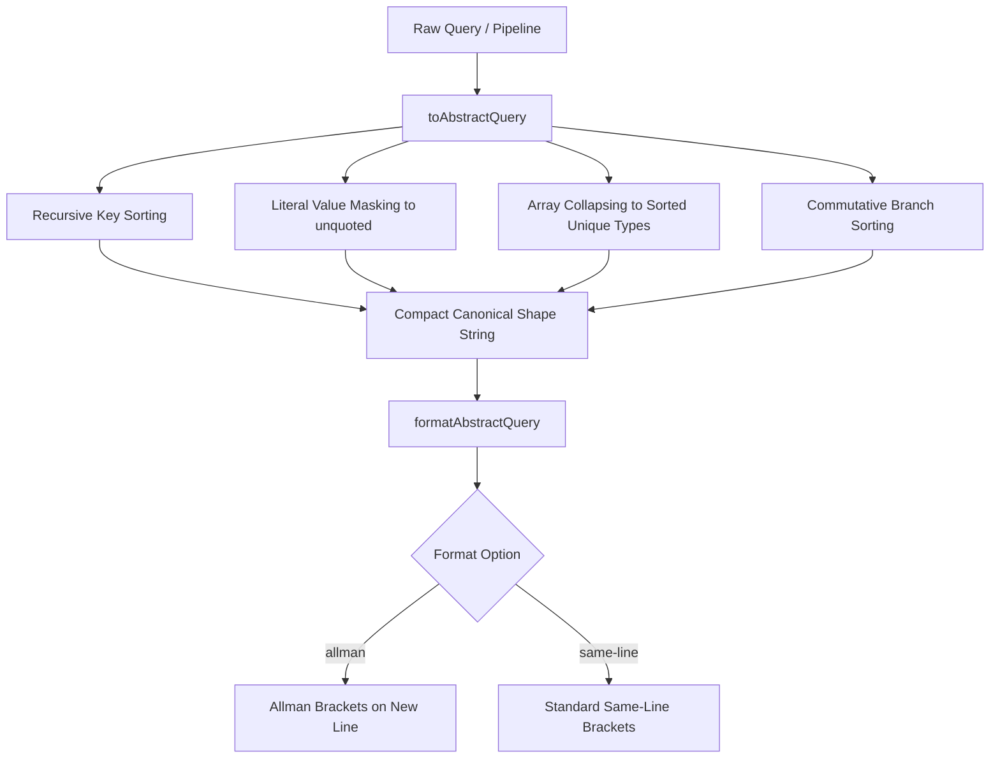
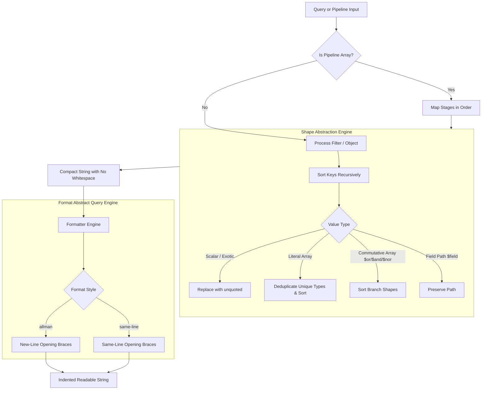

## Goal Capsule

- **Objective:** Provide deterministic query shape extraction and customizable formatting utilities to group, profile, and report on MongoDB query patterns across filter documents and aggregation pipelines.
- **Means:** Implement `toAbstractQuery` to extract compact canonical query shapes with unquoted type markers and sorted keys, and `formatAbstractQuery` to pretty-print shapes with configurable indentation and bracket styles (KTD1, KTD2).
- **Product Authority:** Standalone companion profiling and normalization utilities within `@webergency-utils/mongodb-query-optimizer`; surrounding query optimizer passes and live database execution are out of scope.
- **Open Blockers:** None.

---

## Product Contract

*Product Contract unchanged.*

### Summary
Add `toAbstractQuery` and `formatAbstractQuery` to extract and pretty-print canonical MongoDB query shapes.
The shape generator removes whitespace, sorts object keys recursively, and replaces literal values with unquoted type placeholders like `<string>`, `<number>`, and `<ObjectId>`.
The pretty printer formats the resulting shape with configurable tab sizes and bracket placement, including Allman and same-line styles.

### Problem Frame
Analyzing MongoDB query performance at scale requires grouping queries by structural shape rather than literal argument values.
Without canonical shape normalization, identical query patterns with different parameter values or differing key orders appear as distinct query signatures in logs and profiling reports.
Developers also need human-readable, formatted representations of these shapes that align with repository coding styles such as Allman braces for reporting and documentation.

### Key Decisions
- **Unquoted type placeholders** (session-settled: user-directed — chosen over quoted string placeholders like `"<type>"`: unquoted markers eliminate string-literal quotation ambiguity in query shapes). Governs R2, R11.
- **Type-tagged placeholders** (session-settled: user-directed — chosen over uniform constant placeholder `1`: type tags preserve data-type differentiation for index and execution profiling). Governs R2.
- **Dual query structure support** (session-settled: user-directed — chosen over filter-only input: find queries and aggregation pipelines share a unified shape extraction interface). Governs R1.
- **Unique-type array collapsing** (session-settled: user-directed — chosen over full array preservation or single element collapsing: collapsing to sorted unique type tags normalizes array size variations while preserving mixed-type signatures). Governs R4.
- **Aggregation field path preservation** (session-settled: user-directed — chosen over unconditional string masking: preserving expressions starting with `$` retains pipeline stage and field-binding semantics). Governs R6.
- **Deterministic commutative branch sorting** (session-settled: user-directed — chosen over input-order preservation: sorting branches of `$or`, `$and`, and `$nor` normalizes logically equivalent queries to identical shape keys). Governs R7.
- **Configurable bracket placement and indentation** (session-settled: user-directed — chosen over fixed JSON formatting: supporting Allman and same-line styles accommodates repository formatting conventions in reports and logs). Governs R9, R10.

### Requirements

**Shape Abstraction (`toAbstractQuery`)**
- R1. The `toAbstractQuery` function accepts a MongoDB filter object or aggregation pipeline array and returns a compact canonical string with all whitespace removed.
- R2. The function replaces literal values (strings, numbers, booleans, ObjectIds, Dates, RegExps, Buffers/Binary) with unquoted type placeholders `<string>`, `<number>`, `<boolean>`, `<ObjectId>`, `<Date>`, `<RegExp>`, and `<Binary>`.
- R3. The function preserves literal `null` as `null` without converting it to a type placeholder.
- R4. The function collapses literal value arrays into a deduplicated, deterministically sorted list of unique unquoted type placeholders.
- R5. The function sorts object keys alphabetically at every nesting depth.
- R6. The function preserves aggregation field path references starting with `$` in pipeline stage expressions instead of abstracting them into `<string>`.
- R7. The function sorts branch shapes within commutative logical operators (`$or`, `$and`, `$nor`) deterministically so branch order does not affect the output shape.

**Shape Formatting (`formatAbstractQuery`)**
- R8. The `formatAbstractQuery` function accepts an abstract query shape string or raw query input and returns an indented, multi-line formatted string.
- R9. The function accepts a `tabSize` option (defaulting to 2 spaces) to configure indentation width.
- R10. The function accepts a `format` option controlling bracket placement, supporting `'allman'` (opening bracket on a new line) and `'same-line'` (opening bracket on the same line as the parent).
- R11. The function renders unquoted type placeholders without string quotes in the formatted output.

**Packaging & Ergonomics**
- R12. Both functions are exported from the package's top-level index and built into both ESM (`dist/index.js`) and CJS (`dist/index.cjs`) bundles with complete TypeScript type declarations.

### Visualizations



### Acceptance Examples

- AE1. Basic filter abstraction
  - **Covers:** R1, R2, R3, R5
  - **Input:** `{ status: "active", age: { $gte: 21 }, deletedAt: null }`
  - **Expected Shape:** `{"age":{"$gte":<number>},"deletedAt":null,"status":<string>}`

- AE2. Array collapsing and key normalization
  - **Covers:** R4, R5
  - **Input:** `{ tags: { $in: ["admin", "staff", "moderator"] }, scores: [10, 20] }`
  - **Expected Shape:** `{"scores":[<number>],"tags":{"$in":[<string>]}}`

- AE3. Mixed-type array deduplication
  - **Covers:** R4
  - **Input:** `{ values: [1, "two", 3, "four", true] }`
  - **Expected Shape:** `{"values":[<boolean>,<number>,<string>]}`

- AE4. Commutative branch sorting
  - **Covers:** R7
  - **Input 1:** `{ $or: [{ b: 2 }, { a: "test" }] }`
  - **Input 2:** `{ $or: [{ a: "other" }, { b: 5 }] }`
  - **Expected Shape:** `{"$or":[{"a":<string>},{"b":<number>}]}` (both inputs produce identical shape)

- AE5. Aggregation pipeline field paths
  - **Covers:** R1, R5, R6
  - **Input:** `[ { $match: { teamId: "t1" } }, { $group: { _id: "$role", count: { $sum: 1 } } } ]`
  - **Expected Shape:** `[{"$match":{"teamId":<string>}},{"$group":{"_id":"$role","count":{"$sum":<number>}}}]`

- AE6. Allman style formatting
  - **Covers:** R8, R9, R10, R11
  - **Input:** `toAbstractQuery({ user: { id: "u123", active: true } })`
  - **Options:** `{ format: "allman", tabSize: 2 }`
  - **Expected Output:**
    ```
    {
      "user":
      {
        "active": <boolean>,
        "id": <string>
      }
    }
    ```

- AE7. Same-line style formatting
  - **Covers:** R8, R9, R10, R11
  - **Input:** `toAbstractQuery({ user: { id: "u123", active: true } })`
  - **Options:** `{ format: "same-line", tabSize: 2 }`
  - **Expected Output:**
    ```
    {
      "user": {
        "active": <boolean>,
        "id": <string>
      }
    }
    ```

### Scope Boundaries

- **Deferred for later:**
  - Automated integration with MongoDB profiler collection logs (`system.profile`).
  - Index recommendation synthesis mapped from abstract query shapes.
  - Conversion of shapes back into executable query templates with mock data.
- **Outside this product's identity:**
  - Live database connections or query execution.
  - Modifying optimizer rewrite passes inside `optimizePipeline` or `optimizeFilter`.

### Dependencies / Assumptions
- **Assumptions:**
  - Object key sorting applies JavaScript string comparison (`localeCompare` or standard unicode code point order).
  - Unquoted type tokens are intended for reporting, logging, and inspection rather than strict RFC 8259 JSON parsing.
- **Dependencies:** Zero external runtime dependencies, matching the existing package architecture.

---

## Planning Contract

### Key Technical Decisions

- KTD1. Dedicated Zero-Dependency Implementation Module: All normalization, key sorting, type tagging, and pretty printing logic is implemented in a single cohesive file `src/abstract-query.ts` with zero external dependencies, leveraging internal type checks (`isPlainObject`, exotic object detection) from `src/utils.ts`. Governs R1, R8, R12.
- KTD2. Direct AST Serialization & Formatter Engine: Standard JSON serialization cannot output unquoted values like `<string>`. The implementation will serialize the query directly into a canonical string for `toAbstractQuery`, and implement a recursive character/line indenter in `formatAbstractQuery` that handles bracket placement (`allman` vs `same-line`) and indentation depth without converting through `JSON.stringify`. Governs R2, R8, R9, R10, R11.
- KTD3. BSON and Runtime Type Classification: Inspect values in priority order: `null`, `Date`, `RegExp`, `Buffer` / `Uint8Array`, BSON `ObjectId` (via `_bsontype`, `constructor.name`, or `.toHexString()`), primitive `string`, `number`, `boolean`, `bigint`, arrays, and nested plain objects. Governs R2, R3.
- KTD4. Aggregation Stage and Field Path Discrimination: In `$match`, process as a filter query; in other pipeline stages (`$project`, `$group`, `$addFields`, etc.), inspect string values: strings starting with `$` (field paths like `"$role"`, `"$$ROOT"`) are preserved verbatim, whereas string literal values without `$` (or inside literal containers like `$literal`) are masked as `<string>`. Governs R6.
- KTD5. Commutative Branch Normalization via Lexicographical Shape Sorting: For commutative operators (`$or`, `$and`, `$nor`), recursively compute each branch's shape string and sort the branches lexicographically before joining them into the final operator array shape. Governs R7.

### High-Level Technical Design



### Assumptions & Implementation Constraints
- Preserves radixxko formatting rules (Allman braces, padded parens, semicolons).
- Zero external dependencies added to `package.json`.
- Dual build targets (ESM and CJS) with TypeScript `.d.ts` declaration generation.

---

## Implementation Units

### U1. Core Shape Abstraction Engine (`toAbstractQuery`)
- **Goal:** Implement recursive type abstraction, key sorting, array deduplication, and commutative branch sorting in `src/abstract-query.ts`.
- **Requirements:** R1, R2, R3, R4, R5, R6, R7
- **Dependencies:** None
- **Files:** `src/abstract-query.ts`, `tests/abstract-query.test.ts`
- **Approach:**
  1. Implement type detection function `getTypeTag(val)` returning `<string>`, `<number>`, `<boolean>`, `<ObjectId>`, `<Date>`, `<RegExp>`, `<Binary>`, or `null`.
  2. Implement recursive shape generator `toAbstractQuery(query)`:
     - If null, return `"null"`.
     - If primitive/exotic, return unquoted type tag.
     - If array: check if inside commutative operator (`$or`, `$and`, `$nor`) or normal array. If commutative, recursively format branches and sort strings lexicographically. If normal literal array, map to unique types, sort unique tags, and format as `[<type1>,<type2>]`.
     - If object: sort keys alphabetically. For each key, recursively format value. In aggregation expressions, preserve strings starting with `$` as field paths.
- **Patterns to follow:** `src/utils.ts` (`isPlainObject`, `isOperatorSubdocument`).
- **Test scenarios:**
  - Covers AE1: Scalar literal abstraction (`status: "active"` -> `<string>`, `age: { $gte: 21 }` -> `<number>`, `deletedAt: null` -> `null`).
  - Covers AE2: Literal array collapsing with unique types (`tags: { $in: ["a", "b"] }` -> `{"tags":{"$in":[<string>]}}`).
  - Covers AE3: Mixed-type array deduplication and deterministic sorting (`[1, "two", true]` -> `[<boolean>,<number>,<string>]`).
  - Covers AE4: Commutative branch sorting (`$or: [{ b: 2 }, { a: "test" }]` and `$or: [{ a: "other" }, { b: 5 }]` produce identical shape).
  - Covers AE5: Aggregation pipeline stages and field paths (`$group: { _id: "$role", count: { $sum: 1 } }` -> preserves `"$role"` and masks `1` to `<number>`).
  - Edge cases: Empty objects `{}` -> `"{}"`, empty arrays `[]` -> `"[]"`, non-object query inputs.
- **Verification:** Unit tests pass in `tests/abstract-query.test.ts`.

### U2. Customizable Shape Formatter (`formatAbstractQuery`)
- **Goal:** Implement `formatAbstractQuery` supporting configurable tab size and bracket styles (`'allman'` and `'same-line'`).
- **Requirements:** R8, R9, R10, R11
- **Dependencies:** U1
- **Files:** `src/abstract-query.ts`, `tests/abstract-query.test.ts`
- **Approach:**
  1. Parse shape string or input object into formatted multi-line string.
  2. Track indentation level (multiplied by `tabSize`, defaulting to 2 spaces).
  3. Implement bracket placement:
     - If `format: 'allman'`: place opening `{` and `[` on their own indented line (after key on a new line).
     - If `format: 'same-line'`: place opening `{` and `[` on the same line as the key/parent.
  4. Render unquoted type placeholders (`<string>`, etc.) without adding quotes.
- **Patterns to follow:** `src/utils.ts`, radixxko indentation conventions.
- **Test scenarios:**
  - Covers AE6: Allman style formatting with opening brackets on new line and 2-space indentation.
  - Covers AE7: Same-line style formatting with opening brackets on same line.
  - Configurable `tabSize` (e.g. 4 spaces vs 2 spaces).
  - Direct raw query formatting (`formatAbstractQuery(query)` calls `toAbstractQuery` internally when given an object/array).
  - Nested objects and arrays formatting without extraneous commas or indentation drift.
- **Verification:** Unit tests pass in `tests/abstract-query.test.ts`.

### U3. Public API Exports, Packaging, & Regression Verification
- **Goal:** Export `toAbstractQuery`, `formatAbstractQuery`, and options types from `src/index.ts`, verify TypeScript types, and ensure dual bundle build passes.
- **Requirements:** R12
- **Dependencies:** U1, U2
- **Files:** `src/index.ts`, `tests/abstract-query.test.ts`
- **Approach:**
  1. Re-export functions and type declarations in `src/index.ts`.
  2. Run `npm run typecheck` (`typecheck:source` and `typecheck:tests`).
  3. Run `npm test` and `npm run build` (`tsup`).
- **Test scenarios:**
  - Import `toAbstractQuery` and `formatAbstractQuery` from root package entry point in tests.
  - Verify typecheck passes with no TS errors.
  - Build passes and produces `dist/index.js`, `dist/index.cjs`, and type declarations.
- **Verification:** `npm run typecheck`, `npm test`, and `npm run build` succeed.

---

## Verification Contract

Run the repository test and build suites:

```bash
npm run typecheck
npm test
npm run build
```

---

## Definition of Done

- All R1–R12 requirements implemented and verified.
- All AE1–AE7 acceptance examples covered by automated tests.
- Code conforms to repository formatting guidelines (Allman brackets, padded parens, semicolons).
- TypeScript compiles cleanly with zero type errors.
- ESM and CJS bundles build cleanly with full `.d.ts` type exports.
- No external runtime dependencies added.
