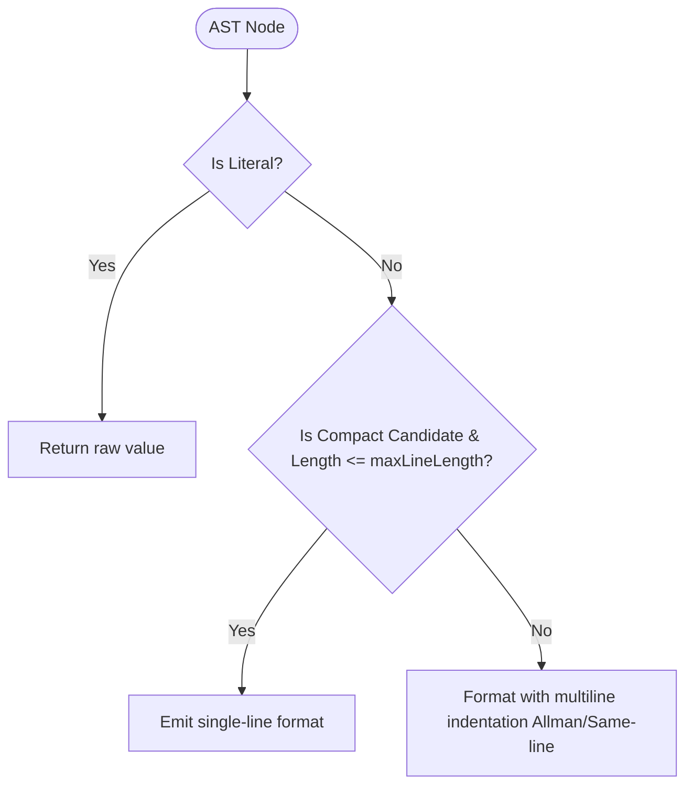

# Feature: Compact Leaf and Tail Query Formatting

## Goal Capsule

- **Objective:** Format abstract MongoDB query trees with compact, single-line leaf and tail expressions so queries remain concise and readable without excessive vertical line bloat.
- **Means:** Introduce AST node compaction rules and a configurable line-width threshold in `formatAbstractQuery` to inline short objects, arrays, leaf operators, and stages.
- **Product Authority:** `radixxko` (@webergency-utils/mongodb-query-optimizer)
- **Open Blockers:** None

---

## Product Contract

> **Product Contract preservation:** Product Contract unchanged from brainstorm.

### Summary

Add compact single-line leaf and tail formatting to `formatAbstractQuery` so comparison operators (e.g. `"$eq": [ "a", "b" ]`), simple filter wrappers (e.g. `deleted: { "$ne": <boolean> }`), scalar/index arrays (e.g. `"$arrayElemAt": [ "$events", 0 ]`), and compact stages (e.g. `{ "$limit": 10 }`, `{ "$sort": { "_id": -1 } }`) render on a single line instead of spanning multiple indented lines.

### Problem Frame

The current abstract query formatter (`formatAst`) splits every non-empty object and any array containing an object across multiple lines with distinct opening and closing braces or brackets.

Under Allman brace style, this causes severe vertical inflation:
- A single leaf comparison like `{ "$eq": [ { "$type": "$events.dropout" }, "date" ] }` expands to 9 lines.
- A simple field filter `deleted: { "$ne": true }` expands to 4 lines.
- Single-spec stages like `{ "$limit": 10 }` or `{ "$sort": { "_id": -1 } }` expand to 4 to 6 lines each.

A typical 6-stage aggregation pipeline routinely exceeds 120 lines, pushing crucial query logic off-screen and hurting scannability.

### Key Decisions

- **KD1 (Leaf and tail node compaction):** Comparison expressions, accumulator leaves, positional indexers, and single-spec stages must render inline on a single line whenever their contents are simple leaves.
  *(session-settled: user-directed — chosen over keeping full multiline expansion: prevents simple leaf operators from exploding query vertical height)*. Governs R1, R2, R3, R4, R5.
- **KD2 (Character length budget threshold):** The formatter must accept an optional `maxLineLength` setting (defaulting to 80 characters) and only format a candidate node on a single line if its rendered width fits within this limit.
  *(session-settled: user-directed — chosen over unlimited single-line inlining: guarantees long strings or wide expressions wrap cleanly rather than exceeding terminal column boundaries)*. Governs R6, R7.
- **KD3 (Structural preservation for branching containers):** Top-level pipelines, `$match` conjunctions with multiple sibling fields, `$switch` branch lists, and nested complex subdocuments must continue using multi-line indentation to preserve structural hierarchy.
  *(session-settled: user-approved — chosen over aggressive whole-query flattening: keeps the macro structure of stages and boolean trees clear and readable)*. Governs R7, R8.

### Requirements

#### Leaf Expression Compaction

- R1. The formatter MUST render binary comparison operators (such as `$eq`, `$ne`, `$gt`, `$gte`, `$lt`, `$lte`, `$in`, `$nin`) and unary type checks (such as `$type`) on a single line when their arguments fit within `maxLineLength`.
- R2. The formatter MUST render array indexing and slicing operators (such as `$arrayElemAt`, `$slice`, `$indexOfArray`, `$substrCP`) on a single line when their arguments fit within `maxLineLength`.
- R3. The formatter MUST render accumulator and window expressions (such as `$sum`, `$avg`, `$first`, `$last`, `$push`) on a single line when their inner expression is an identifier or scalar fitting within `maxLineLength`.
- R4. The formatter MUST render single-condition field filters (e.g. `deleted: { "$ne": <boolean> }` or `status: { "$in": [ <string> ] }`) on a single line if the combined key and child object fit within `maxLineLength`.

#### Stage Inlining

- R5. The formatter MUST render simple, single-field pipeline stages (such as `$limit`, `$skip`, `$count`, and single-key `$sort` specs like `{ "$sort": { "_id": -1 } }`) as single-line object entries in pipeline arrays if they fit within `maxLineLength`.

#### Configuration & Line Budget

- R6. The `formatAbstractQuery` function MUST support an optional `maxLineLength` configuration option (default `80`, minimum `20`).
- R7. When a candidate compact node exceeds `maxLineLength` or contains multiline children that cannot be compacted, the formatter MUST fall back to standard multiline indentation.
- R8. The formatter MUST preserve the selected brace style (`allman` vs `same-line`) for all multiline blocks and never place closing braces on an inconsistent indentation level.

### Acceptance Examples

- AE1. Leaf comparison with type sub-expression
  - **Covers:** R1, R6
  - **Given:** An abstract query node `{ "$eq": [ { "$type": "$events.dropout" }, "date" ] }`
  - **When:** Formatted with default `maxLineLength: 80`
  - **Then:** Renders as `"$eq": [ { "$type": "$events.dropout" }, "date" ]` on a single line.

- AE2. Field filter with comparison operator
  - **Covers:** R4, R6
  - **Given:** An abstract query property `deleted: { "$ne": true }`
  - **When:** Formatted under `allman` mode
  - **Then:** Renders as `deleted: { "$ne": true }` on a single line instead of breaking `deleted:` and `{` onto separate lines.

- AE3. Simple pipeline stages
  - **Covers:** R5, R6
  - **Given:** Pipeline stages `{ "$limit": 10 }` and `{ "$sort": { "_id": -1 } }`
  - **When:** Formatted within an aggregation pipeline array
  - **Then:** Each renders as a single line `{ "$limit": 10 }` and `{ "$sort": { "_id": -1 } }`.

- AE4. Long expression exceeding line budget
  - **Covers:** R7, R8
  - **Given:** An `$in` expression with 20 string literals exceeding 80 characters
  - **When:** Formatted with `maxLineLength: 80`
  - **Then:** Falls back to multiline array formatting with standard indentation.

### Scope Boundaries

- **In scope:** Inline compaction of leaf operators, accumulator leaves, positional indexers, field-level leaf filters, and single-spec stages in `formatAbstractQuery` / `formatAst`; adding `maxLineLength` to `FormatAbstractQueryOptions`.
- **Outside this product's identity:** Minification of the entire query into a single string (the goal is human-readable, compact formatting, not JSON minification).
- **Deferred to Follow-Up Work:** Heuristic auto-detection of terminal column width from `process.stdout.columns`.

---

## Planning Contract

### Key Technical Decisions

- KTD1. **AST Node Single-Line Feasibility Analysis** (Governs R1, R2, R3, R4, R5)
  Implement `isCompactCandidate(node: AstNode, maxDepth = 2): boolean` to classify whether an AST node qualifies for inline formatting:
  - Literal nodes are always compactable.
  - Array nodes qualify if all element children are compactable, contain no nested branch lists or multiline stages, and fit within the line length limit.
  - Object nodes qualify if they have $\le 3$ scalar/leaf properties or represent a single operator/stage (e.g. `$eq`, `$ne`, `$gt`, `$type`, `$limit`, `$sort`), with no complex sub-pipelines.
- KTD2. **Single-Line Stringifier with Budget Check** (Governs R6, R7)
  Implement `formatSingleLine(node: AstNode): string` that renders a node into a single line (`{ "a": 1, "b": 2 }`, `[ 1, 2 ]`).
  In `formatAst`, before indenting an object or array, compute the prospective single-line representation. If `isCompactCandidate(node)` is true and `indent + keyPrefix + singleLine.length <= maxLineLength`, format the property or array element inline on a single line.
- KTD3. **Allman and Same-Line Compatibility** (Governs R8)
  Ensure that inline compaction overrides the multiline Allman brace split for leaf nodes (e.g. emitting `key: { ... }` or `key: [ ... ]` directly), while preserving standard Allman newline and brace alignment whenever a node exceeds `maxLineLength` or contains multiline children.
- KTD4. **Public Option `maxLineLength`** (Governs R6)
  Add `readonly maxLineLength?: number` to `FormatAbstractQueryOptions` with default value 80.

### High-Level Technical Design

---

## Implementation Units

### U1. AST Compactor and Single-Line Formatter Engine

- **Goal:** Implement compactibility classification and single-line serialization helper functions.
- **Requirements:** R1, R2, R3, R4, R6, R7
- **Files:** `src/abstract-query.ts`
- **Approach:**
  - Extend `FormatAbstractQueryOptions` with `readonly maxLineLength?: number`.
  - Implement `formatSingleLine(node: AstNode): string`.
  - Implement `isCompactCandidate(node: AstNode, depth?: number): boolean`.
- **Test Scenarios:**
  - Happy path: Format literal nodes, single-key leaf objects (`{ "$ne": true }`), scalar arrays (`[ 1, 2 ]`), and simple nested leaves (`{ "$eq": [ { "$type": "$x" }, "date" ] }`) on a single line.
  - Edge case: Deeply nested objects or arrays with 4+ levels reject compact candidate status to prevent overly dense single lines.
  - Error path: Zero-length objects `{}` and arrays `[]` render correctly as `{}` and `[]`.
- **Verification:** Unit tests in `tests/abstract-query.test.ts`.

### U2. Formatter Integration for Inline Properties and Array Elements

- **Goal:** Integrate compaction logic into `formatAst` so qualified object properties and array elements render compactly on single lines.
- **Requirements:** R1, R2, R3, R4, R5, R7, R8
- **Files:** `src/abstract-query.ts`
- **Approach:**
  - Update `formatAst` object property loop: if `isCompactCandidate(value)` and current line fits within `options.maxLineLength`, output `key: ${formatSingleLine(value)}` on one line without splitting braces, even in Allman mode.
  - Update `formatAst` array element loop: if an element is a compact object/array (e.g. `{ "$limit": 10 }` or `{ "$sort": { "_id": -1 } }`), render it as `${indent}${singleLine}` on one line instead of expanding across 3-6 lines.
  - Preserve multiline formatting when width budget is exceeded or children are not compactable.
- **Test Scenarios:**
  - Happy path: Allman mode outputs `deleted: { "$ne": true }` on a single line instead of 4 lines.
  - Happy path: Aggregation pipeline containing `{ "$limit": 10 }` renders stage on 1 line instead of 3 lines.
  - Happy path: Aggregation pipeline containing `{ "$sort": { "_id": -1 } }` renders stage on 1 line instead of 6 lines.
  - Edge case: Line exceeding `maxLineLength` wraps gracefully to multiline Allman.
- **Verification:** `npm test tests/abstract-query.test.ts`.

### U3. Comprehensive Test Coverage and Regression Validation

- **Goal:** Validate compact formatting against existing test suites and add dedicated tests for new leaf compaction behaviors.
- **Requirements:** R1, R2, R3, R4, R5, R6, R7, R8
- **Files:** `tests/abstract-query.test.ts`
- **Approach:**
  - Add tests for leaf comparison operators, indexers, accumulators, stages, custom `maxLineLength` budgets, and Allman/same-line parity.
  - Run the entire test suite (all 43 test suites, 995+ tests) to guarantee zero regressions.
- **Test Scenarios:**
  - Happy path: Verify user's aggregation query example produces compact leaf lines for `$eq`, `$type`, `$ne`, `$lt`, `$gt`.
  - Boundary test: `maxLineLength: 40` forces multiline wrapping on long arrays while `maxLineLength: 120` keeps them compact.
  - Regression test: Existing shape abstraction and normalization tests continue passing.
- **Verification:** `npm run typecheck && npm test && npm run build`.

---

## Verification Contract

| Command | Purpose | Expected Outcome |
|---|---|---|
| `npm run typecheck` | TypeScript compilation check | Zero type errors |
| `npm test` | Run entire test suite (Vitest) | All 43 suites, 995+ tests pass |
| `npm run build` | Bundle library with `tsup` | Clean build in `dist/` |

---

## Definition of Done

- `formatAbstractQuery` supports compact leaf and tail formatting.
- `maxLineLength` option available in `FormatAbstractQueryOptions` and defaulted to 80.
- All unit tests pass; 100% clean typecheck; clean build.
- Clean git diff with no temporary files or regressions.
