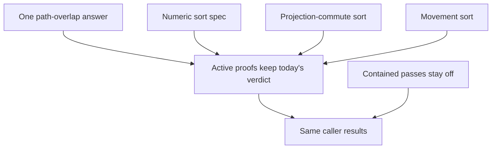
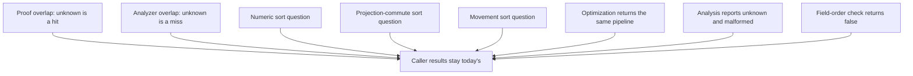

# Shared Optimizer Safety Checks - Plan

## Goal Capsule

- **Objective:** Callers of `optimizePipeline`, `optimizeFilter`, and `getStageInfo` keep today's results for the same input and options.
- **Means:** Share only the proof copies that already agree, and leave the checks that already differ in place (KTD1, KTD2, KTD3, KTD4).
- **Product Authority:** radixxko (@webergency-utils/mongodb-query-optimizer)
- **Authority order:** Product Contract requirements win on behavior. Key Technical Decisions win on mechanism within those requirements. Implementation Units override neither.
- **Stop conditions:** Stop if a public result would change, a contained pass would run in production, or a check that KTD1 through KTD5 keep separate would be merged.
- **Execution profile:** Add characterization coverage for a check before moving or renaming it.
- **Who finishes:** The package maintainer implements the units and ships the change.
- **Open Blockers:** None

---

## Product Contract

> **Product Contract preservation:** restructured, no scope change: R3 names the agreeing proof copies; R7 adds the field-order outcome already produced today; AE10 and AE11 record those existing edges.

### Summary

One restructuring shares the proof checks that already agree and leaves the checks that already differ in place. Each proof keeps the verdict it has today, so the same pipeline and options still optimize the same way. `getStageInfo` stays the compatibility view callers already receive.

### Problem Frame

Path overlap is the same comparison copied in several proofs. Sort legality is three different questions, and two of them share a name. Adjacent movement, removal, and nested traversal each grew their own walk.

A maintainer who changes one copy leaves the others behind. Collapsing the three sort questions into one verdict would change which pipelines move.

### Key Decisions

- **One restructuring** *(session-settled: user-directed — chosen over scoping only path and sort safety: the five cleanups are one piece of work)*. Governs R3, R4, R5, R6, R7, R8, R9.
- **Current verdicts** *(session-settled: user-approved — chosen over one sort verdict: today's pipelines keep moving the same way)*. Governs R1, R4, R5.
- **Today's error default** *(session-settled: user-directed — chosen over requiring the error to still be raised: a failing query may fail from another stage, or succeed when the failing row is dropped)*. Governs R2.

### Actors

- A1. The maintainer of `@webergency-utils/mongodb-query-optimizer`, who changes the shared checks.
- A2. A caller of `optimizePipeline`, `optimizeFilter`, or `getStageInfo`.

### Requirements

**Caller results**

- R1. The same pipeline or filter, with the same options, still produces the same `optimizePipeline`, `optimizeFilter`, and `getStageInfo` results as today.
- R2. This plan leaves the guarantees in `CONSTRAINTS.md` sections 1 through 4 unchanged.

**Shared checks**

- R3. The proof copies that already treat any non-disjoint path relation as overlap share one definition, and that definition keeps their current answer, including for an unknown path.
- R4. Sort legality remains three questions, and each proof keeps the question it asks today: a numeric `$sort` spec, a projection-commute sort, and a movement sort.
- R5. Adjacent movement keeps today's verdict for each pair it already rewrites.
- R6. Lookup delay keeps its own proof and its current verdict.
- R7. Nested-pipeline traversal keeps today's outcomes when a nested pipeline points back at an ancestor: optimization returns the same pipeline, analysis reports it unknown and malformed, and the field-order check returns false.
- R8. `getStageInfo` keeps the return shape already required by KTD2 in `docs/plans/2026-09-04-001-fix-mongodb-query-optimizer-correctness-plan.md`.

**Contained passes**

- R9. `stage-priority-reorder`, `redundant-projection-elimination`, `covered-projection-synthesis`, and `dead-assignment-elimination` stay contained, and sharing a proof with an active pass does not enable them.

### Key Flows

- F1. Optimize a pipeline
  - **Trigger:** A2 calls `optimizePipeline` with a pipeline and optional options.
  - **Actors:** A2
  - **Steps:** Resolve options the way `CONSTRAINTS.md` sections 2 through 4 already require. Apply active proofs with their current verdicts. Leave the passes in R9 off.
  - **Outcome:** The result matches today for that input.
  - **Covered by:** R1, R2, R9

### Acceptance Examples

- AE1. Same caller result
  - **Covers:** R1
  - **Given:** A pipeline and options that `optimizePipeline` accepts today
  - **When:** `optimizePipeline` runs after this work
  - **Then:** The result equals today's result for that input

- AE2. Default error relaxation
  - **Covers:** R2
  - **Given:** A read pipeline with no options, where a later expression would throw on a row an earlier match or limit can drop
  - **When:** `optimizePipeline` runs
  - **Then:** The query may succeed, as it may today

- AE3. Strict errors
  - **Covers:** R2
  - **Given:** The pipeline from AE2, with `strictErrors` set
  - **When:** `optimizePipeline` runs
  - **Then:** Error timing stays as strict mode requires today

- AE4. Write pipeline
  - **Covers:** R2
  - **Given:** A pipeline that contains `$out` or `$merge`, and no options
  - **When:** `optimizePipeline` runs
  - **Then:** Errors stay strict, as they do today

- AE5. Divergent sort questions
  - **Covers:** R4
  - **Given:** A `$sort` whose key the analyzer does not treat as an exact path, such as `{ "$sort": { "a.": 1 } }`
  - **When:** The numeric-spec question, the projection-commute question, and the movement question are asked
  - **Then:** The numeric-spec question accepts it, and the projection-commute and movement questions reject it

- AE6. Production run skips contained passes
  - **Covers:** R9
  - **Given:** The production optimizer
  - **When:** It optimizes a pipeline
  - **Then:** The four passes in R9 still do not run

- AE7. Cyclic pipeline is not optimized
  - **Covers:** R7
  - **Given:** A pipeline whose nested pipeline points back at an ancestor
  - **When:** `optimizePipeline` runs
  - **Then:** The pipeline is returned unchanged

- AE8. Cyclic pipeline analysis stays conservative
  - **Covers:** R7
  - **Given:** The pipeline from AE7
  - **When:** Stage analysis walks it
  - **Then:** The cyclic pipeline is reported unknown and malformed, and it is not walked again

- AE9. Stage info shape
  - **Covers:** R1, R8
  - **Given:** A stage `getStageInfo` accepts today
  - **When:** `getStageInfo` runs
  - **Then:** The returned fields and values match today's result

- AE10. Cyclic field-order check
  - **Covers:** R7
  - **Given:** The pipeline from AE7
  - **When:** The field-order check walks it
  - **Then:** The check returns false

- AE11. Wildcard sort key
  - **Covers:** R4
  - **Given:** `{ "$sort": { "*": 1 } }`
  - **When:** The numeric-spec question, the projection-commute question, and the movement question are asked
  - **Then:** The numeric-spec question and the projection-commute question accept it, and the movement question rejects it

### Success Criteria

- `npm test` passes. That script runs `vitest run --project unit`.

### Scope Boundaries

- New rewrites, and a second query planner.
- Enabling a contained pass. See R9.
- Changing the `getStageInfo` return shape. See R8.
- Changing which pipelines move. See R1 and R4.
- A shared swap that only delegates to the existing pair proofs. See KTD3.
- Switching dead-assignment onto the unused-field kill proof. See KTD5.
- Folding the analyzer overlap check or the safe-merge check into the shared proof predicate. See KTD1.

### Dependencies / Assumptions

- R2 takes `CONSTRAINTS.md` sections 1 through 4 as the equivalence authority. This plan records no delta against that file.
- R8 takes KTD2 in `docs/plans/2026-09-04-001-fix-mongodb-query-optimizer-correctness-plan.md` as the stage-info authority.
- "Today" means the source of this package on the branch where planning starts, not a previously built `dist`.

### Sources / Research

- `CONSTRAINTS.md` sections 1 through 4, for membership, field order, errors, and writes.
- `docs/plans/2026-09-04-001-fix-mongodb-query-optimizer-correctness-plan.md`, KTD2, for the `getStageInfo` return shape.
- `src/passes/top-k-proofs.ts`, `src/passes/projection-proofs.ts`, and `src/passes/movement-proofs.ts`, for the three sort questions.
- `src/passes/shadow-proofs.ts`, `src/passes/movement-proofs.ts`, `src/passes/add-field-pushdown-proofs.ts`, and `src/passes/projection-proofs.ts`, for the identical path-overlap loops.
- `src/analyzer/paths.ts`, where analyzer overlap treats an unknown path as a miss.
- `src/analyzer/index.ts`, where `getStageInfo` projects richer stage analysis.
- `src/passes/registry.ts`, for the contained pass ids and for returning a cyclic pipeline unchanged.
- `src/utils.ts`, for cycle detection across every object, not only nested pipeline slots.
- `src/analyzer/semantics.ts`, for reporting a cyclic pipeline unknown and malformed.
- `src/passes/guarantee-guards.ts`, for the field-order check returning false on re-entry.

---

## Planning Contract

### Key Technical Decisions

- KTD1. **One proof overlap predicate.** The shared definition is the existing proof answer: any relation other than disjoint is overlap, including unknown. It lives in one proof module and replaces the duplicated proof loops. Analyzer overlap, path cover, and the safe-merge check stay separate. A single helper for proofs and the analyzer was not developed further because it would change caller results. *(session-settled: user-approved — chosen over one overlap helper for proofs and the analyzer: an unknown path is a hit in the proofs and a miss in the analyzer)*. Governs R1, R3.
- KTD2. **Three sort functions.** The numeric-spec question, the projection-commute question, and the movement question stay three functions with three names. Their conditions are copied, not merged. The projection question keeps its `*` exception. The movement question keeps rejecting `*`, `?`, and any path that is not exact. *(session-settled: user-approved — chosen over one sort function: `{ "$sort": { "a.": 1 } }` and `{ "$sort": { "*": 1 } }` do not share a verdict)*. Governs R1, R4.
- KTD3. **Pair proofs stay in their passes.** Match pushdown, limit advance, sort-project commute, projection deferral, and lookup delay keep their current proofs and call sites. There is no shared swap, including one that only delegates. `provePrioritySwap` keeps calling the match and limit proofs without a guarantee context. Making that context required was not developed further because it would change the contained priority pass. *(session-settled: user-approved — chosen over a shared swap that only delegates: the pair proofs already differ, and a wrapper would not change a verdict)*. Governs R5, R6, R9.
- KTD4. **Three cycle mappings.** Optimization keeps the full-object cycle check and returns the same pipeline. Analysis keeps its pipeline-array re-entry and reports unknown and malformed. The field-order check keeps returning false on re-entry. One handler was not developed further because those three outcomes are not one value, and the optimizer check walks objects that are not nested pipelines. *(session-settled: user-approved — chosen over one cycle handler: the three callers do not share a result)*. Governs R1, R7, R8.
- KTD5. **Dead-assignment keeps its removal proof.** It may keep calling the shared dependency read. It does not switch onto the unused-field kill proof, and its pass stays off the production list. *(session-settled: user-approved — chosen over switching it onto the unused-field kill proof: the two proofs are not established as the same answer)*. Governs R9.
- KTD6. **Registry membership stays.** Production keeps running only the active id list. The four contained ids stay off that list. `expr-match-normalization` stays registered and stays off both the active list and the contained list. The pre-gate test helper and the active filter-rule list stay as they are. *(session-settled: user-approved — chosen over cleaning inactive ids into active or contained: that would change which rewrites run)*. Governs R1, R2, R9.

### High-Level Technical Design

The proof overlap predicate is the only new shared answer. Everything else in this plan is a boundary: a check that already differs stays behind that boundary.

### Sequencing

U1 lands first because U2 edits the same proof files. U3 and U4 do not depend on U1. None of the units edit the production id lists.

### Risks

- Pointing a proof at analyzer overlap changes verdicts for unknown paths such as `a.` and `?`.
- Replacing the optimizer's full-object cycle check with the analyzer's pipeline re-entry starts optimizing cycles that are not nested pipelines.
- Dropping `malformed` on a cyclic child changes the conservative `getStageInfo` result, because that adapter takes the conservative branch when the summary is malformed.
- Files this work touches require 100% branch coverage under `npm run coverage`. `npm test` does not enforce that threshold. A new branch fails the coverage script until a test hits it.
- The pre-gate test helper is not production. It already includes `expr-match-normalization` and excludes the four contained passes. Changing that helper changes what most unit tests call.

### System-Wide Impact

A2 sees the same public results. A1 gets one proof overlap predicate and three named sort questions. No caller option, registry membership, or filter rule changes.

### Alternatives Considered

- One overlap helper for proofs and the analyzer. Rejected by KTD1.
- One sort function. Rejected by KTD2.
- One cycle handler. Rejected by KTD4.
- A shared swap that only delegates to the pair proofs. Rejected by KTD3.
- Switching dead-assignment onto the unused-field kill proof. Rejected by KTD5.

---

## Implementation Units

### U1. Share the proof overlap predicate

- **Goal:** One proof function answers path overlap for every copy that already uses the non-disjoint test.
- **Requirements:** R1, R3. KTD1.
- **Dependencies:** None.
- **Files:**
  - `src/passes/path-disjoint.ts` (create)
  - `src/passes/shadow-proofs.ts`
  - `src/passes/add-field-pushdown-proofs.ts`
  - `src/passes/movement-proofs.ts`
  - `src/passes/projection-proofs.ts`
  - `src/passes/top-k-proofs.ts`
  - `tests/path-disjoint.test.ts` (create)
- **Approach:**
  1. Put the shared predicate in a new proof module. New code uses the package's radixxko style. Edits inside an existing file match that file's style.
  2. Replace the duplicated proof loops, including the single-path form in movement proofs, with that function.
  3. Leave analyzer overlap, path cover, collision checks, and the safe-merge check in place.
  4. A local-dependency read may call the shared predicate. It still reads only local dependencies.
- **Execution note:** Add a failing characterization for an unknown path before deleting the local copies.
- **Patterns to follow:** The loop in `src/passes/shadow-proofs.ts` is the answer to copy. `src/analyzer/paths.ts` is the answer not to call.
- **Test scenarios:**
  - Covers R3. Two exact paths that do not overlap are disjoint. An ancestor and a descendant are not disjoint. An unknown path against any other path is not disjoint. Two empty lists are disjoint.
  - The analyzer overlap check still returns false for `?` against an ordinary field. This test lives with the existing analyzer coverage, not in the new proof test, if that case is already locked.
  - Existing top-k, add-field pushdown, and shadow proof tests pass without a changed optimized pipeline.
- **Verification:** The four proof files no longer contain a private copy of the loop. `npm test` passes. A new branch in a covered file is hit by a test.

### U2. Name the three sort questions

- **Goal:** Each sort question has one name and keeps the verdict it has today.
- **Requirements:** R1, R4. KTD2.
- **Dependencies:** U1
- **Files:**
  - `src/passes/top-k-proofs.ts`
  - `src/passes/projection-proofs.ts`
  - `src/passes/movement-proofs.ts`
  - `src/passes/sort-project-commute.ts`
  - `src/passes/complex-projection-deferral.ts`
  - `src/passes/lookup-delay.ts`
  - `tests/top-k-pushdown.test.ts`
  - `tests/semantic-edge-coverage.test.ts`
  - `tests/lookup-passes.test.ts`
- **Approach:**
  1. Give the three questions distinct names. The numeric question stays the shape-only check top-k uses. The projection question stays the analyzer-gated check used before a project or add-fields crosses a sort. The movement question stays the check match pushdown and lookup delay use.
  2. Move them into one module only when each function's conditions are copied exactly and the module does not import a pass. Otherwise leave each function in its current file under the new name.
  3. Do not add a guarantee context to these questions. Do not push the guarantee move-check into the projection question. Sort-project commute still does not consult guarantees. Deferral still consults them in the pass, after the proof.
- **Execution note:** Lock AE5 and AE11 with characterization tests before renaming call sites.
- **Patterns to follow:** The direction check shared by all three is `1` or `-1` on a non-empty plain `$sort`. The extra gates stay the ones already beside each question.
- **Test scenarios:**
  - Covers AE5. `{ "$sort": { "a.": 1 } }` is accepted by the numeric question and rejected by the projection and movement questions.
  - Covers AE11. `{ "$sort": { "*": 1 } }` is accepted by the numeric and projection questions and rejected by the movement question.
  - `{ "$sort": { "score": -1, "_id": 1 } }` is accepted by all three.
  - `{ "$sort": { "a": 2 } }`, an empty sort, and a non-sort stage are rejected by all three.
  - A simple flag project that keeps the sort key visible still moves before a plain sort. An add-fields stage whose writes overlap the sort key still does not move across that sort.
  - A lookup followed by a sort on `*` still does not delay. A lookup followed by a plain local sort that does not read the alias still delays, as it does today.
- **Verification:** No remaining pair of sort helpers shares a name. The scenarios above pass. Optimized pipelines in the existing sort, lookup, and movement tests are unchanged.

### U3. Lock the three cycle outcomes

- **Goal:** A cyclic nested pipeline keeps the three results R7 names, without merging the walks.
- **Requirements:** R1, R7, R8. KTD4.
- **Dependencies:** None
- **Files:**
  - `tests/cyclic-pipeline.test.ts`
- **Approach:**
  1. Do not change the optimizer pre-check, the analysis re-entry, or the field-order re-entry.
  2. Extend the cyclic test so analysis of a lookup, facet, and unionWith cycle reports unknown and malformed, and the field-order check returns false. The optimize result stays the same reference.
  3. Leave acyclic nested optimization as it is. A lookup subpipeline that is not cyclic still rewrites.
- **Execution note:** This unit is characterization only. Do not extract a shared walker.
- **Patterns to follow:** `tests/cyclic-pipeline.test.ts` already locks the same-reference optimize result and the unknown analysis summary.
- **Test scenarios:**
  - Covers AE7. A self-referential lookup, facet, and unionWith pipeline each come back as the same reference from `optimizePipeline`.
  - Covers AE8. Analysis of that lookup reports the pipeline unknown and malformed and does not walk the cycle again.
  - Covers AE10. The field-order check on that pipeline returns false.
  - An acyclic lookup subpipeline still rewrites, as the existing acyclic case requires.
  - Stages outside a cyclic lookup still keep today's optimize result. Today that result is the original pipeline, because the optimizer returns before the sweep.
- **Verification:** The new assertions pass. No file under `src/` changes in this unit.

### U4. Lock stage info and registry membership

- **Goal:** `getStageInfo` values and the production pass list stay as they are.
- **Requirements:** R1, R2, R8, R9. KTD4, KTD6.
- **Dependencies:** None
- **Files:**
  - `tests/analyzer-semantics.test.ts`
  - `tests/containment.test.ts`
  - `tests/registry-proof-manifest.test.ts`
  - `tests/gate-status.test.ts`
- **Approach:**
  1. Do not edit `getStageInfo`, the production id lists, the pre-gate helper, or the filter-rule lists.
  2. Add a characterization for `getStageInfo` on a stage whose analysis is the cyclic unknown summary, if that case is not already locked. The result uses the conservative field sets and `isUnknown`.
  3. Keep the existing registry and gate tests as the lock on AE6.
- **Patterns to follow:** `tests/containment.test.ts` locks the observable `getStageInfo` shape. `tests/registry-proof-manifest.test.ts` freezes the active and contained id lists.
- **Test scenarios:**
  - Covers AE9. A known stage returns the same ten fields and the same set contents as today. Richer analysis fields are absent.
  - Covers AE6. The production id list still omits the four contained passes and `expr-match-normalization`. A production optimize of `{ "$match": { "$expr": { "$eq": ["$a", 1] } } }` stays unchanged.
  - A cyclic lookup stage passed to `getStageInfo` is unknown, destructive, and count-altering, with the conservative field sets.
- **Verification:** Those tests pass without a production source edit. `npm test` passes.

---

## Verification Contract

- `npm test` is the required gate. It runs `vitest run --project unit`.
- When a unit adds a branch in a file that `vitest.config.ts` covers at 100% branches, `npm run coverage` passes too. That script is `vitest run --project unit --coverage`.
- U1 is proved by `tests/path-disjoint.test.ts` plus the existing top-k, add-field, and shadow tests.
- U2 is proved by the AE5 and AE11 scenarios in the sort, semantic-edge, and lookup tests.
- U3 is proved by `tests/cyclic-pipeline.test.ts`.
- U4 is proved by the analyzer, containment, registry-manifest, and gate-status tests.

---

## Definition of Done

- R1 through R9 hold, and AE1 through AE11 pass.
- U1 through U4 are complete, including each unit's test scenarios.
- `npm test` passes.
- The production id lists, the pre-gate helper, the filter-rule lists, and `CONSTRAINTS.md` sections 1 through 4 are unchanged.
- Abandoned experiments are not left in the diff.
