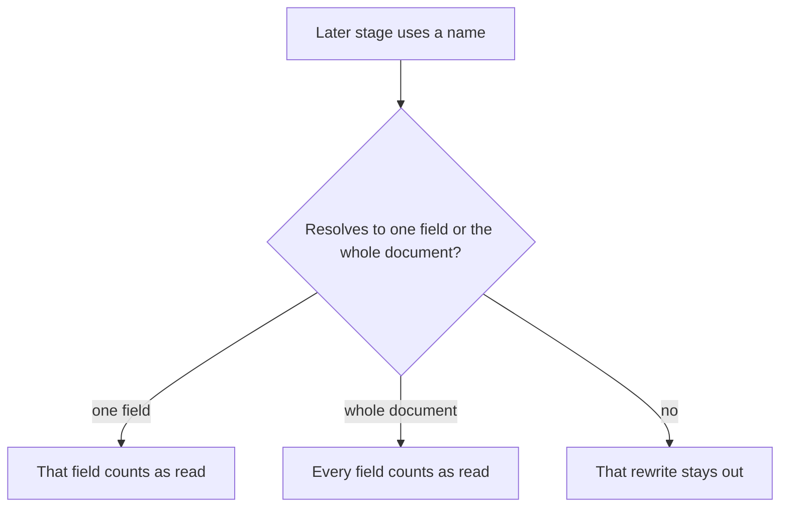
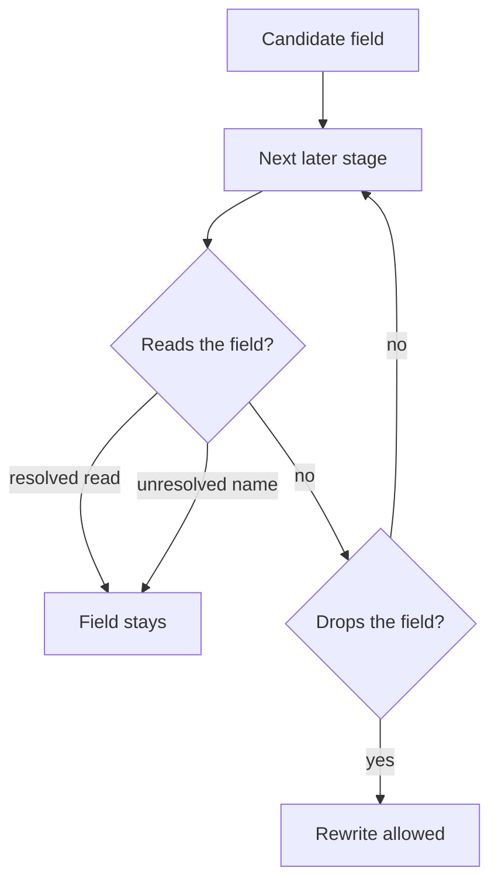

# Follow Renamed Reads - Plan

## Goal Capsule

- **Objective:** A caller of `optimizePipeline` still receives the same document values in the same document order after production removes an unread assignment or drops fields a collapsing stage does not read.
- **Means:** Follow a `let`, a `$$` name, a lookup `as`, or a field alias to the field it points at, and leave that rewrite out when the name does not resolve (R3, R4).
- **Product Authority:** `@webergency-utils/mongodb-query-optimizer`
- **Stop conditions:** Stop if a change would violate R5, R6, R8, or R9.
- **Execution profile:** Enable the two rewrites in production, and extend rename tracking only as far as R3 and R4 require.
- **Who finishes:** The package maintainer.
- **Open Blockers:** None

---

## Product Contract

> **Product Contract preservation:** changed: Dependencies / Assumptions — a use that runs only after the field is already dropped does not keep the assignment. Changed: R1 — an exact top-level assignment can be removed; a dotted assignment such as `a.b` stays, matching the proof this plan does not widen.

### Summary

Production will run dead-assignment removal and covered projection. A field read through a `let`, a `$$` name, a lookup `as`, or another field's alias still counts as a read of that field. A name that does not resolve leaves that rewrite out. The documents come back in the same order.

### Problem Frame

Dead-assignment removal and covered projection are already written, and production does not run them. A later stage can read a field under another name: a `let` variable, a `$$` name, a lookup `as`, or a field copied into a second field.

Removing or projecting away the source field in that case changes the documents the caller receives. Leaving every pipeline that mentions a variable unchanged would also leave copies that no name reads.

### Key Decisions

- **Follow the name.** *(session-settled: user-approved — chosen over stopping at every variable, and over shipping a rewrite only when two server runs match: a provable copy can still be removed, and the decision stays in the proof)*. Governs R3, R4.
- **Both rewrites run in production.** *(session-settled: user-directed — chosen over enabling `$expr` folding, priority reorder, or redundant projection removal: those three can change which documents come back or their order)*. Governs R1, R2, R9.
- **Document property order may change.** *(session-settled: user-directed — chosen over keeping every key in the same place: the result bar for these passes allows property order to change)*. Governs R5.
- **Dead-assignment keeps its own removal question.** *(session-settled: user-approved — chosen over switching onto the unused-field kill proof: the two questions are not the same)*. Governs R8.
- **These two rewrites do not use the optimizer's looser error rule.** *(session-settled: user-approved — chosen over allowing a failing query to succeed when a row is dropped: a caller asked for a query that still fails when it failed)*. Governs R6.

<!-- ce-section: work-relationships -->
### How This Work Fits Together

This plan enables dead-assignment removal and covered projection. That is the current area. The surrounding containment is the current understanding, not a roadmap.

- `docs/plans/2026-10-13-1324-refactor-shared-optimizer-safety-checks-plan.md` left both passes contained. This plan enables those two and leaves that plan's other separations in place.
- `docs/plans/2026-10-06-1237-fix-correctness-hardening-plan.md` said the contained passes could enter a later release. This plan is that release for these two passes only.
- Priority reorder, redundant projection removal, and `$expr` folding can proceed independently of this plan. They are not active scope.

### Requirements

**Production rewrites**

- R1. Production optimization removes an exact top-level assignment whose value is absent from the output and that no later stage reads, including under another name. A dotted assignment such as `a.b` stays.
- R2. Production optimization may drop fields in front of a collapsing stage when that stage's result does not depend on them, including through another name.

**Renames**

- R3. A `let`, a `$$` name, a lookup `as`, or a field copied into another field counts as a read of the one source field it resolves to. A name that resolves to the whole document counts as a read of every field.
- R4. A name that does not resolve to one concrete field or the whole document blocks the rewrite that would remove or project away a field that name might read.

**Results**

- R5. A query that succeeds returns the same documents in the same order. Property order inside a document may change.
- R6. A rewrite that makes a failing query succeed, or a succeeding query fail, does not run.
- R7. When R1 and R2 both apply to one pipeline, the composed result still satisfies R5 and R6.

**Boundaries**

- R8. Dead-assignment removal is allowed only when a later stage drops the assigned field without reading it. It is not decided by the unused-field pruning rule.
- R9. `$expr` match folding, priority reordering, and redundant projection removal stay out of production.

### Key Flows

- F1. Unread copy
  - **Trigger:** A caller optimizes a pipeline whose assignment is absent from the output and unread under every name.
  - **Steps:** The assignment is removed. The caller runs the optimized pipeline.
  - **Outcome:** R5 and R6 hold.
  - **Covered by:** R1, R3, R5, R6
- F2. Renamed read
  - **Trigger:** A caller optimizes a pipeline that reads a field through a resolved name.
  - **Steps:** That field stays. A name that does not resolve blocks the rewrite that depended on the field being unread.
  - **Outcome:** The value that traveled through the name is still in the result.
  - **Covered by:** R3, R4, R5
- F3. Both rewrites
  - **Trigger:** A caller optimizes a pipeline where an unread assignment and a covered projection both apply.
  - **Steps:** The second rewrite sees the first rewrite's pipeline.
  - **Outcome:** R7 holds.
  - **Covered by:** R1, R2, R7

### Acceptance Examples

- AE1. Unread copy removed
  - **Covers R1, R5.**
  - **Given:** `{ $set: { tmp: "$price" } }` followed by a projection that keeps only `name`.
  - **When:** Production optimizes the pipeline and the query succeeds.
  - **Then:** The `tmp` assignment is gone, and the documents match the original pipeline aside from property order.
- AE2. `let` still reads the source
  - **Covers R3, R5.**
  - **Given:** `tmp` is set from `$price`, and a later stage returns `$$v` from a `let` whose `v` is `$tmp`.
  - **When:** Production optimizes the pipeline.
  - **Then:** The `tmp` assignment remains, and the returned value still equals `price`.
- AE3. Whole document is every field
  - **Covers R3, R4.**
  - **Given:** A collapsing stage whose key is `$$ROOT`.
  - **When:** Production optimizes the pipeline.
  - **Then:** No covered projection drops fields in front of that stage.
- AE4. Unbound name blocks the rewrite
  - **Covers R4, R5.**
  - **Given:** An assignment of `tmp`, and a later stage that reads an unbound `$$name`.
  - **When:** Production optimizes the pipeline.
  - **Then:** The rewrite that would drop `tmp` does not run, and the documents match the original pipeline aside from property order.
- AE5. Covered projection keeps the group inputs
  - **Covers R2, R5.**
  - **Given:** A group on `customerId` that sums `amount`, with no variable.
  - **When:** Production optimizes the pipeline and the query succeeds.
  - **Then:** Fields the group does not depend on may be absent in front of the group, and the group documents match the original pipeline aside from property order.
- AE6. Covered projection follows a `let`
  - **Covers R2, R3.**
  - **Given:** A group that reads `amount` through a `let` bound to `$amount`.
  - **When:** Production optimizes the pipeline.
  - **Then:** `amount` is not projected away before the group.
- AE7. Failure stays a failure
  - **Covers R6.**
  - **Given:** An assignment whose removal would make a failing query succeed.
  - **When:** Production optimizes the pipeline.
  - **Then:** That assignment stays.
- AE8. Composed rewrites
  - **Covers R7.**
  - **Given:** One pipeline where an unread assignment and a covered projection both apply.
  - **When:** Production optimizes the pipeline and the query succeeds.
  - **Then:** The documents match the original pipeline in count and order, aside from property order.
- AE9. Inactive rewrites stay inactive
  - **Covers R9.**
  - **Given:** `{ $match: { $expr: { $eq: ["$a", 1] } } }`.
  - **When:** Production optimizes the pipeline.
  - **Then:** That match is unchanged.

### Scope Boundaries

- `$expr` match folding, priority reordering, and redundant projection removal stay out of production (R9).
- The optimizer's looser error rule for other passes stays as it is. This plan tightens failure behavior only for these two rewrites (R6).
- A server comparison of the original and rewritten pipelines is not the shipping rule (see the follow-the-name decision).
- Separations kept by `docs/plans/2026-10-13-1324-refactor-shared-optimizer-safety-checks-plan.md`, other than containment of these two passes, stay in place.

### Dependencies / Assumptions

- Behavior is judged on MongoDB 8, the server this package targets.
- A name is unresolved when analysis cannot point it at one concrete field or at the whole document. `$$ROOT` and `$$CURRENT` are whole-document names, not unresolved names.
- A lookup that can see the incoming document is a whole-document read under R3.
- A use that runs only after a later stage has already dropped the field does not keep that assignment (R1). The original pipeline has already discarded the value.

### Sources / Research

- `src/passes/registry.ts` lists `dead-assignment-elimination` and `covered-projection-synthesis` as contained, and lists `unused-field-pruning` as active.
- `src/analyzer/expressions.ts` binds `$let` vars before the `in` expression, and records an unbound `$$` name as reading `*` with `unknown`.
- `src/analyzer/semantics.ts` records a `$lookup` `let` before it analyzes the subpipeline.
- `src/guarantees.ts` documents the default that a failing query may fail differently or succeed. R6 does not use that default.
- `CONSTRAINTS.md` relaxes document field order by default.
- `docs/plans/2026-10-13-1324-refactor-shared-optimizer-safety-checks-plan.md` kept dead-assignment on its own removal proof and kept both passes contained.
- `tests/fixtures/proof-manifest.ts` has no gate record for either pass.

---

## Planning Contract

### Key Technical Decisions

- KTD1. **A resolved variable is a normal read.** The analyzer already copies a bound `let` or `$$` name into `dependencies.local`. The proofs use that path. `dependencies.variables.size > 0` is not by itself a block when every variable name resolved to an exact local path. A name that did not resolve, or a local `*`, blocks the rewrite that would drop a field it might read (R3, R4). A use only after the killing stage is not a read of the assignment.
- KTD2. **A plain field copy is followed.** A specification entry whose value is a single field path, not a `$$` name and not an expression, makes a later read of the target a read of the source. Chains of plain copies follow to the source. An expression copy does not resolve and blocks under R4. `src/passes/movement-proofs.ts` keeps its own alias helper. These proofs do not call it.
- KTD3. **Failure stays failure even when `strictErrors` is false.** `canRemoveStage` only applies that check when the flag is on, so these passes do not use it as their error rule (R6). When `strictFieldOrder` is true, dead-assignment does not remove an assignment whose removal would change the order of keys that survive. A covered projection in front of a collapsing stage does not change the final key order, because that stage builds the output document. When `strictFieldOrder` is false, R5 allows a surviving key to move.
- KTD4. **Production membership follows the existing gate.** Move `covered-projection-synthesis` and `dead-assignment-elimination` from the contained list to the active list, in that order, immediately after `unused-field-pruning`. The pre-gate helper gains the same two ids. `expr-match-normalization` stays off the active list and stays in the pre-gate helper (R1, R2, R7, R9).
- KTD5. **Dead-assignment keeps `proveDeadAssignmentElimination`.** Alias and variable reads feed that proof's existing read check. The proof does not call `proveUnusedFieldPruningThroughSuffix` (R8). A later `$group`, `$count`, or `$sortByCount` that the scan reaches, whose dependencies are known, and that does not read the field, is a drop inside this proof. The covered projection is inserted after leading `$match` stages, before prefix assignments, so it is not that drop.

### High-Level Technical Design

A candidate field is removed or projected away only after the suffix is classified. A resolved read keeps the field, including a read on the stage that would otherwise drop it. An unresolved name keeps the field. A drop that already happens in the original pipeline, with no read of the field on or before that stage, allows the rewrite.

A `$project` that copies the field, such as `{ shown: '$tmp' }`, is a read on the dropping stage. An overwrite that reads the field is the same. A collapsing stage whose dependencies are known, and that does not read the field, is a drop. Covered projection still inserts after leading `$match` stages. That inserted stage is not the drop for an assignment that runs after it. The composed pipeline still has to satisfy R7.

### Sequencing

U1 makes resolved and unresolved names visible to both proofs. U2 adds plain alias chains on top of that read check. U3 applies the failure and field-order guards. U4 turns the passes on only after those three hold.

### Risks

- A stage can carry both an exact local path and a second variable that did not resolve. Ignoring `variables` because some local path is exact would drop a field the unresolved name might read. Every variable name has to resolve, or the rewrite stays out.
- A lookup that can see the incoming document is a whole-document read. Treating it as a read of only `localField` would remove a field the subpipeline can still see.
- R5 allows key order to change when `strictFieldOrder` is false. Callers who set the flag do not get that relaxation (KTD3).

### System-Wide Impact

Callers of `optimizePipeline` get two more production rewrites. Document values and document order stay the same. Other passes keep the package's looser error rule. `$expr` folding, priority reorder, and redundant projection removal stay off.

### Alternatives Considered

- Blocking every stage that mentions a variable. Rejected with the follow-the-name decision. A bound name that points at one field is a read, and an unread copy can still be removed.
- Shipping a rewrite only when two server runs match. Rejected with that same decision. The proof decides. No new live comparison suite is part of this work.

---

## Implementation Units

### U1. Count resolved names and block unresolved ones

- **Goal:** Both proofs treat a resolved variable as a read of its source field, and an unresolved variable as a block on the rewrite that would drop a field it might read.
- **Requirements:** R3, R4, F2, AE2, AE3, AE4, AE6
- **Dependencies:** None
- **Files:** `src/passes/projection-proofs.ts`, `src/passes/dead-assignment-proofs.ts`, `src/passes/covered-projection-proofs.ts`, `tests/dead-assignment-elimination.test.ts`, `tests/covered-projection-synthesis.test.ts`
- **Approach:**
  - Keep using `dependencies.local` for a name the analyzer has already resolved.
  - Stop treating `dependencies.variables.size > 0` as a block when every name in that map resolved to an exact local path.
  - A local `*`, an unknown dependency, or a variable name with no exact resolved path blocks the rewrite (KTD1).
  - `$$ROOT` and `$$CURRENT` stay whole-document reads.
  - Do not switch dead-assignment onto the unused-field proof (KTD5).
  - Inside that proof, a later `$group`, `$count`, or `$sortByCount` that the scan reaches, whose dependencies are known, and that does not read the field is a drop. Do not treat the covered projection as that drop. Its insert point stays after leading `$match` stages.
- **Execution note:** Add the cases below before changing the barrier, so today's refusal of a bound `let` is visible and the new allowance is the change under test.
- **Patterns to follow:** `hasOnlyKnownDependencyPaths` in `src/passes/projection-proofs.ts` and the bound-variable cases in `tests/semantic-edge-coverage.test.ts`.
- **Test scenarios:**
  - Covers AE2. `{ $set: { tmp: '$price' } }` then `{ $set: { shown: { $let: { vars: { v: '$tmp' }, in: '$$v' } } } }`. `proveDeadAssignmentElimination` returns null, including when a later project drops `tmp`.
  - Covers AE3. A pipeline whose only collapsing stage is `{ $group: { _id: '$$ROOT', n: { $sum: 1 } } }`. `proveCoveredProjectionSynthesis` returns null.
  - Covers AE4. `{ $set: { tmp: 1 } }`, then a stage that reads unbound `$$name`, then `{ $unset: 'tmp' }`. The dead-assignment proof returns null.
  - Covers AE6. `{ $group: { _id: { $let: { vars: { v: '$amount' }, in: '$$v' } }, n: { $sum: 1 } } }`. The synthesized projection includes `amount`.
  - `{ $set: { tmp: 1 } }`, then a `let` that reads only `$other`, then a projection that keeps only `name`. The `tmp` assignment is removed. The `let` does not block it.
  - `{ $set: { tmp: 1 } }` then `{ $group: { _id: '$customerId', n: { $sum: '$amount' } } }`. The `tmp` assignment is removed. The group still receives `customerId` and `amount`.
  - `{ $set: { 'a.b': 1 } }` followed by `{ $unset: 'a.b' }` still returns null (R1).

### U2. Follow plain field copies

- **Goal:** A later read of a plain copy counts as a read of the source, including through a chain of plain copies.
- **Requirements:** R3, R4, F2
- **Dependencies:** U1
- **Files:** `src/passes/dead-assignment-proofs.ts`, `src/passes/covered-projection-proofs.ts`, `tests/dead-assignment-elimination.test.ts`, `tests/covered-projection-synthesis.test.ts`
- **Approach:**
  - Apply KTD2 inside these two proofs only. Leave `extractDirectAliases` in `src/passes/movement-proofs.ts` where it is.
  - A value that is a single `$field` path links the target to that source. A `$$` name or any other expression does not link, and blocks under R4 when the rewrite would drop the source.
  - Walk a chain of plain copies back to the source. Stop the chain when a step is not a plain path.
- **Patterns to follow:** The plain-path test in `extractDirectAliases` (`src/passes/movement-proofs.ts`).
- **Test scenarios:**
  - `{ $set: { price: 1 } }`, `{ $set: { tmp: '$price' } }`, `{ $set: { shown: '$tmp' } }`, then a projection that keeps only `shown`. The `price` assignment stays, and `shown` still equals `1` under the mock pipeline comparison already used by the dead-assignment tests.
  - `{ $set: { a: 1 } }`, `{ $set: { b: '$a' } }`, `{ $set: { c: '$b' } }`, then a read of `$c` before a projection that drops `a`. The `a` assignment stays.
  - `{ $set: { a: 1 } }`, `{ $set: { b: { $add: ['$a', 1] } } }`, then a read of `$b` before a projection that drops `a`. The `a` assignment stays.
  - `{ $set: { a: 1 } }`, a projection that drops `a`, then `{ $set: { b: '$a' } }`. The later copy does not keep the `a` assignment.
  - `{ $set: { tmp: '$price' } }` then `{ $project: { shown: '$tmp' } }`. The `tmp` assignment stays, because the projection reads it. `shown` still equals `price`.

### U3. Keep failure and honor field order

- **Goal:** These two rewrites do not change whether the query fails, and they do not change key order when `strictFieldOrder` is set.
- **Requirements:** R5, R6, AE7
- **Dependencies:** U1
- **Files:** `src/passes/dead-assignment-elimination.ts`, `src/passes/covered-projection-synthesis.ts`, `src/passes/dead-assignment-proofs.ts`, `src/passes/covered-projection-proofs.ts`, `tests/dead-assignment-elimination.test.ts`, `tests/covered-projection-synthesis.test.ts`
- **Approach:**
  - Both `execute` methods take `GuaranteeContext`, matching `PipelinePass`.
  - Dead-assignment still removes only an `isSafePrunableAssignment`. That check stays in force when `strictErrors` is false (KTD3). Do not route the decision through `canRemoveStage`.
  - Covered projection returns null when the collapsing stage, or a stage between the insertion point and that stage, has unknown errors.
  - When `strictFieldOrder` is true, dead-assignment skips a removal that would change the order of keys that survive (KTD3). Covered projection is not skipped for that reason: the collapsing stage builds the output document.
  - When `strictFieldOrder` is false, R5 applies.
- **Patterns to follow:** The `execute` signature of `src/passes/unused-field-pruning.ts`, without copying its `canRemoveStage` gate.
- **Test scenarios:**
  - Covers AE7. `{ $set: { tmp: { $divide: ['$a', 0] } } }` then `{ $unset: 'tmp' }`, with the default guarantee context. The proof returns null.
  - The same pipeline with `strictErrors: true`. The proof still returns null.
  - A group on `customerId` that sums `amount`, with a prefix `{ $addFields: { extra: { $function: { body: 'function() { return 1 }', args: [], lang: 'js' } } } }`. Covered projection returns null.
  - `{ $set: { tmp: 1 } }` then `{ $set: { kept: '$name', tmp: 'later' } }`, with `strictFieldOrder: true`. The first `tmp` assignment stays, because removing it would place `tmp` after `kept`.
  - The same pipeline with the default context. The first `tmp` assignment may be removed. `tmp` is still `later` and `kept` is still `name`.
  - A group on `customerId` that sums `amount`, with `strictFieldOrder: true` and no other fields read. Covered projection may still drop unread fields. The group documents match.

### U4. Run both passes in production

- **Goal:** `optimizePipeline` runs both rewrites, and the other inactive rewrites stay off.
- **Requirements:** R1, R2, R7, R9, F1, F3, AE1, AE5, AE8, AE9
- **Dependencies:** U1, U2, U3
- **Files:** `src/passes/registry.ts`, `tests/helpers/pre-gate-optimizer.ts`, `tests/fixtures/proof-manifest.ts`, `tests/fixtures/generated-interactions.ts`, `tests/gate-status.test.ts`, `tests/dead-assignment-elimination.test.ts`, `tests/covered-projection-synthesis.test.ts`, `README.md`, `SUPPORT.md`, `CONSTRAINTS.md`
- **Approach:**
  - Move the two ids from `containedPipelineTransformationIds` to `activePipelineTransformationIds`, immediately after `unused-field-pruning`, covered projection first (KTD4).
  - Add the same two ids to `PRE_GATE_PIPELINE_TRANSFORMATION_IDS`. Leave `expr-match-normalization` in that helper and off the active list.
  - Add an active gate record for each pass, shaped like the `unused-field-pruning` entry. `dead-assignment-elimination` uses `strictModeBehavior: 'constrained'` because `strictFieldOrder` can refuse a removal the default context allows. `covered-projection-synthesis` uses `'preserved'`: U3 does not skip it for field order, and its unknown-error refusal does not depend on `strictErrors`. `proofRecheckNote` states that a resolved name is a read, an unresolved name blocks, and failure is preserved when `strictErrors` is false.
  - Extend generated interactions the same way that entry's `u9-generated-top-level-*` and `u9-generated-nested-*` ids are produced.
  - Update the public lists in `README.md`, `SUPPORT.md`, and `CONSTRAINTS.md` so the contained and active names match the registry.
- **Patterns to follow:** The active `unused-field-pruning` record in `tests/fixtures/proof-manifest.ts` and the contained-id assertions in `tests/gate-status.test.ts`.
- **Test scenarios:**
  - Covers AE1. Production `optimizePipeline` on `{ $set: { tmp: '$price' } }` plus a projection that keeps only `name` removes the `tmp` assignment. The mock pipeline comparison matches aside from property order.
  - Covers AE5. Production `optimizePipeline` on a group of `customerId` summing `amount` may drop other fields before the group. The group documents match aside from property order.
  - Covers AE8. One production pipeline where both an unread assignment and a covered projection apply. Document count and order match the original.
  - Covers AE9. Production `optimizePipeline` of `{ $match: { $expr: { $eq: ['$a', 1] } } }` leaves that match unchanged.
  - `stage-priority-reorder` and `redundant-projection-elimination` stay in the contained list and stay out of the pre-gate helper.
  - `gate-status` still reports the pre-gate list and the active list as the same set, plus `expr-match-normalization` remaining pre-gate-only.

---

## Verification Contract

- From `mongodb-query-optimizer`, `npm test` passes.
- `npm run coverage` passes, including the per-file branch thresholds already configured for the proof files these units edit.
- `npm run typecheck` passes.
- AE1 through AE9 are covered by the scenarios in U1 through U4. No new live MongoDB comparison suite is required.

---

## Definition of Done

- Production optimization removes an unread assignment and may insert a covered projection, and a resolved or unresolved later name still protects a field it might read (R1, R2, R3, R4).
- A query that succeeds returns the same document values in the same document order. A surviving key moves only when `strictFieldOrder` is false (R5, KTD3).
- A rewrite that would change whether the query fails does not run, including under the default guarantee context (R6).
- Both rewrites may run on one pipeline, and the composed result still satisfies R5 and R6 (R7).
- Dead-assignment still uses its own proof (R8). `$expr` folding, priority reorder, and redundant projection removal stay out of production (R9).

