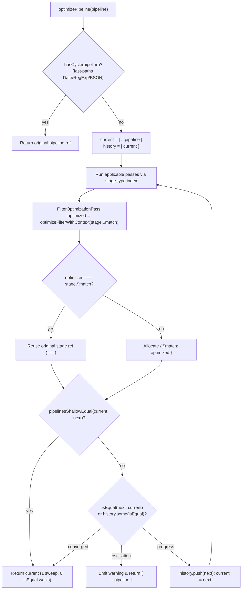
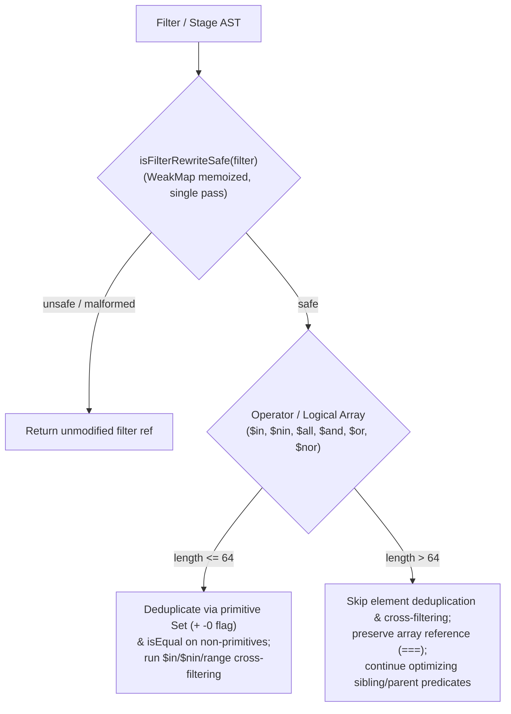

# Optimizer Engine Speedups and Fingerprint Removal - Plan

## Goal Capsule

- **Objective:** Callers optimizing MongoDB aggregation pipelines and filter documents containing multi-thousand-element operator arrays receive semantically identical optimized queries in sub-millisecond time without mutating caller inputs.
- **Means:** Replace string structural fingerprinting with short-circuiting BSON-aware `isEqual` and primitive `Set`s (KTD1, KTD2), adopt copy-on-write with root-only shallow cloning (KTD3), cap element-level array analysis at 64 items (KTD2), and memoize/fast-path safety and dependency traversals (KTD4, KTD5).
- **Authority Hierarchy:** `Product Contract` governs product scope and behavior (`R1`–`R14`); `Planning Contract` governs technical mechanism (`KTD1`–`KTD5`); `Implementation Units` (`U1`–`U5`) sequence the changes within those constraints.
- **Stop Conditions:** All units `U1`–`U5` complete, `Verification Contract` commands pass (including 100% branch coverage on gated files), and the 3,121-element `ObjectId` `$in` pipeline benchmark completes in `< 2 ms` per call.
- **Open Blockers:** None.

---

## Product Contract

**Product Contract preservation:** restructured, no scope change: `R2`, `R3`, and `R13` updated with exact repository file paths discovered during planning research.

### Summary

Overhaul the optimizer's structural comparison, cloning, array-analysis bounds, and safety/dependency traversal paths so pipelines containing large operator or logical arrays optimize in sub-millisecond time with near-zero intermediate allocation. Update `README.md` to reflect the copy-on-write reference semantics, structural equality model, array analysis cap, and refreshed performance benchmarks.

### Problem Frame

Production query logs surfaced 162 out of 515 aggregation queries taking 370–1,077 ms inside `optimizePipeline` when a `$match` stage contained a 3,121-element BSON `ObjectId` `$in` array. Even after memoizing BSON constructor inspection, a single call on that pipeline still takes ~56 ms and allocates ~14 MB of transient heap objects because the engine eagerly deep-clones the entire pipeline, serializes full filter and stage trees into string fingerprints across multiple sweeps, re-allocates `$match` wrappers on no-op passes, and repeatedly walks every `$in` element during safety, cycle, and expression checks.

### Key Decisions

- **Replace string fingerprinting with `isEqual` and primitive `Set`s:** Remove `structuralFingerprint` completely in favor of a cycle-safe, key-order-sensitive, BSON-aware `isEqual(a, b)` plus native `Set`s for primitive lookups. (session-settled: user-directed — chosen over retaining `structuralFingerprint` with `WeakMap` object-key caching; Governs R1, R2, R3)
- **Cap element-level array deduplication and set/interval analysis at 64 items:** Treat operator and logical arrays with more than 64 items as opaque to element-level deduplication, `$in`/`$nin`/range cross-filtering, and `$or` scalar consolidation while still optimizing sibling and parent predicates. (session-settled: user-directed — chosen over a 256-item cap or adding a configurable `OptimizerOptions` threshold; Governs R4, R5)
- **Adopt copy-on-write over upfront `deepClone`:** Remove `deepClone` in favor of shallow root cloning (`[ ...pipeline ]` and `{ ...filter }`) and reference-preserving copy-on-write across all passes and filter sweeps. (session-settled: user-directed — chosen over keeping upfront `deepClone` on `optimizePipeline`; Governs R6, R7, R8)
- **Eliminate redundant safety, cycle, and AST traversals:** Consolidate `isFilterRewriteSafe` into a single memoized zero-allocation walk, fast-path exotic/BSON leaves in `hasCycle`, memoize default-context `analyzeFilter`, guard `simplifyBooleanAbsorption`, and prune redundant array walks in `containsGetField`, `guarantee-guards.ts`, `HeuristicMatchPushdownPass`, and `toAbstractQueryInternal`. (session-settled: user-approved — chosen over leaving per-rule safety and dependency checks uncached; Governs R9, R10, R11, R12, R13)
- **Document updated engine semantics and performance metrics in `README.md`:** Include `README.md` updates in scope so public documentation matches the copy-on-write contract, 64-item array analysis bound, and updated throughput metrics. (session-settled: user-directed — chosen over code-only changes; Governs R14)

### Requirements

**Structural Equality & Fingerprint Removal**

- R1. Remove `structuralFingerprint` from `src/utils.ts` and replace all equality, convergence, and oscillation checks in `src/` with a BSON-aware, key-order-sensitive, cycle-safe `isEqual(a, b)` helper that short-circuits on reference equality and first mismatched key or element.
- R2. Replace fingerprint-keyed maps, sets, and equality checks in `src/filter-optimizer.ts`, `src/filter-rule-registry.ts`, `src/passes/registry.ts`, `src/passes/bucket-filter-pushdown.ts`, `src/passes/group-filter-pushdown.ts`, `src/passes/unwind-prefilter.ts`, `src/passes/facet-proofs.ts`, and `src/passes/expression-simplification.ts` with `isEqual` comparisons and native primitive `Set`s.
- R3. Update internal test suites that import `structuralFingerprint` (`tests/convergence-and-interactions.test.ts`, `tests/generated-interactions.test.ts`, `tests/limit-skip-coalescing.test.ts`, `tests/projection-passes.test.ts`, and `tests/real-world-dependencies.test.ts`) to assert structural equivalence through `isEqual`.

**Bounded Array Deduplication & Set Analysis**

- R4. Skip element-level array deduplication, `$in`/`$nin`/range cross-filtering, and `$or`-to-`$in` consolidation when an individual `$in`, `$nin`, `$all`, `$and`, `$or`, or `$nor` array contains more than 64 elements.
- R5. Preserve all rewrites on sibling fields, parent logical wrappers, and pipeline stages when an oversized array (`> 64` elements) is present in the same filter or pipeline, while still validating that oversized arrays remain well-formed and rewrite-safe before moving or merging their enclosing predicate.

**Copy-on-Write & Reference Preservation**

- R6. Remove `deepClone` from `src/utils.ts` and all callers in `src/`, returning a new root array from `optimizePipeline` and a new root object from `optimizeFilter` while sharing unmodified stage, sub-filter, array, and BSON leaf references via copy-on-write.
- R7. Preserve exact stage and sub-object identity (`===`) across `FilterOptimizationPass`, `optimizeFilterWithContext`, and `applyFilterSweep` whenever a pass, sweep, or child transformation produces no semantic change, while preserving unmodified stage element references (`result[i] === pipeline[i]`) in `UnusedFieldPruningPass`, `DeadAssignmentEliminationPass`, `AdjacentMatchMergingPass`, and `trimCountNeutralPrefix`.
- R8. Update mutation-isolation tests in `tests/containment.test.ts`, `tests/convergence-and-interactions.test.ts`, `tests/gate-status.test.ts`, and `tests/filter-optimizer.test.ts` so they verify non-mutation of inputs during optimization and copy-on-write reference sharing for untouched stages and values.

**Fast-Path Safety, Cycle, and Dependency Analysis**

- R9. Refactor `isFilterRewriteSafe` in `src/analyzer/filters.ts` into a single-pass check memoized by `WeakMap<object, boolean>` that verifies pure operator objects directly without calling `analyzeFilter` and only allocates a cycle-tracking `WeakSet` when descending into nested plain objects or arrays.
- R10. Fast-path `Date`, `RegExp`, and exotic/BSON objects in `hasCycle` (`src/utils.ts`) before `WeakSet` insertion or `Object.values()` allocation.
- R11. Memoize default-context `analyzeFilter` results in `src/analyzer/filters.ts` using a `WeakMap<object, FilterSummary>`.
- R12. Guard `simplifyBooleanAbsorption` in `src/filter-optimizer.ts` so `$and` absorption only runs when at least one branch contains `$or`, and intra-`$or` absorption only runs when at least one branch contains `$and` or a multi-condition object.
- R13. Stop `containsGetField` (`src/passes/movement-proofs.ts`), `filterReadsFieldOrder`, and `expressionReadsFieldOrder` (`src/passes/guarantee-guards.ts`) from recursing into query-filter `$in`/`$nin` literal arrays, `$literal` operands, or BSON/exotic leaf items; eliminate intermediate `.map()` array allocation in `toAbstractQueryInternal` (`src/abstract-query.ts`); and require `HeuristicMatchPushdownPass` (`src/passes/heuristic-match-pushdown.ts`) to verify that both a costly stage or `$function` call and a computed-field provider precede a `$match` before decomposing its conjuncts.

**Documentation**

- R14. Update `README.md` to document copy-on-write reference sharing for `optimizePipeline` and `optimizeFilter`, BSON-aware `isEqual` convergence and deduplication, the 64-item array analysis cap, and updated benchmark numbers.

### Acceptance Examples

- AE1. **Covers R4, R5:**
  - **Given:** A pipeline `[{ $match: { _id: { $in: [<3121 ObjectIds>] }, status: { $in: ["active", "active"] } } }, { $match: { tenantId: "t1" } }]`.
  - **When:** `optimizePipeline` runs on the pipeline.
  - **Then:** The two `$match` stages merge, `status.$in` deduplicates to `["active"]`, and the 3,121-element `_id.$in` array is preserved intact by reference (`output[0].$match._id.$in === input[0].$match._id.$in`) without element-by-element deduplication.
- AE2. **Covers R1, R4:**
  - **Given:** A filter with `<= 64` elements containing distinct BSON values or key-order-significant subdocuments, such as `{ tags: { $in: [new ObjectId("65b9f1a0e4b0a1b2c3d4e5f6"), new ObjectId("65b9f1a0e4b0a1b2c3d4e5f6"), { a: 1, b: 2 }, { b: 2, a: 1 }] } }`.
  - **When:** `optimizeFilter` runs on the filter.
  - **Then:** The duplicate `ObjectId` is collapsed while both `{ a: 1, b: 2 }` and `{ b: 2, a: 1 }` are retained in order because document key order is semantically significant in MongoDB equality matching.
- AE3. **Covers R5, R9:**
  - **Given:** A filter containing a 100-element `$or` array where element 75 contains an unsupported operator `{ $where: "this.a > 1" }` alongside `{ a: { $in: [1, 1] } }`.
  - **When:** `optimizeFilter` runs on the filter.
  - **Then:** `isFilterRewriteSafe` detects the unsafe `$where` element in a single pass and returns the filter without rewriting sibling predicates, preserving fail-closed safety even when the array exceeds 64 items.
- AE4. **Covers R6, R7, R8:**
  - **Given:** An already-optimal pipeline `const input = [{ $match: { createdAt: new Date("2026-01-01T00:00:00Z") } }, { $limit: 10 }]`.
  - **When:** `const output = optimizePipeline(input)` runs.
  - **Then:** `output !== input`, `output[0] === input[0]`, `output[1] === input[1]`, and `output[0].$match.createdAt === input[0].$match.createdAt`, without mutating `input`.

### Success Criteria

- Optimizing the 5-stage benchmark pipeline containing a 3,121-element BSON `ObjectId` `$in` array completes in `< 2 ms` per call with minimal transient heap allocation.
- All existing unit, property, fuzz, coverage, and MongoDB integration tests pass, with updated assertions only where tests imported `structuralFingerprint` or asserted upfront `deepClone` reference inequality on unmodified stages/leaves.
- `npm run test:all` passes cleanly with 100% branch coverage on all gated files in `vitest.config.ts` and zero regressions in optimization capabilities for arrays with `<= 64` items.

### Scope Boundaries

- Adding new configuration properties to `OptimizerOptions`.
- Altering canonicalization or rewrite semantics for filters and arrays with `<= 64` elements.
- Changing the public TypeScript exports in `src/index.ts`.

### Sources / Research

- `src/utils.ts` (`isEqual`, `structuralFingerprint`, `hasCycle`, `deepClone`, `isExoticObject`)
- `src/filter-optimizer.ts` (`optimizeFilterWithRules`, `applyFilterSweep`, `simplifyBooleanAbsorption`, `simplifyFieldIntervals`, `deduplicateOperatorArray`)
- `src/filter-rule-registry.ts` (`simplifySingleFieldOperator`, `simplifyDisjunctionIdentitiesRule`, `deduplicateConjunctionsRule`, `flattenLogicalArray`)
- `src/analyzer/filters.ts` (`isFilterRewriteSafe`, `isRewriteSafeFieldCondition`, `isRewriteSafeFieldOperator`, `isRewriteSafeBsonLiteral`, `analyzeFilter`)
- `src/passes/registry.ts` (`optimizePipelineWithPasses`, `applyGlobalSweepWithDirty`, `pipelinesShallowEqual`)
- `src/passes/filter-optimization.ts` (`FilterOptimizationPass`)
- `src/passes/movement-proofs.ts` (`containsGetField`, `pushLimitToSubpipeline`, `pushMatchIntoLookup`)
- `src/passes/guarantee-guards.ts` (`filterReadsFieldOrder`, `expressionReadsFieldOrder`)
- `src/passes/heuristic-match-pushdown.ts` (`proveHeuristicMatchPushdown`)
- `src/abstract-query.ts` (`toAbstractQueryInternal`)
- `docs/plans/2026-09-04-001-fix-mongodb-query-optimizer-correctness-plan.md` and `docs/plans/2026-10-13-1324-refactor-shared-optimizer-safety-checks-plan.md`

---

## Planning Contract

### Key Technical Decisions

- KTD1. **Semantic parity in `isEqual(a, b)` via `Object.is`, positional key order, BSON `_bsontype` dispatch, and lazy cycle tracking:** Upgrade `isEqual` in `src/utils.ts` so it preserves every semantic distinction previously enforced by `structuralFingerprint` while short-circuiting on the first mismatch. Specifically, start with `Object.is(a, b)` so `NaN` equals `NaN` and `-0` differs from `+0`; compare `Date` timestamps with `Object.is(a.getTime(), b.getTime())`; compare `ArrayBuffer` and `ArrayBufferView` (`Buffer`, `Uint8Array`, `DataView`) byte-for-byte with constructor/view parity; compare `Map` and `Set` entries in insertion order; dispatch `_bsontype` values (`ObjectId`, `Decimal128`, `Long`, `Timestamp`, `Double`, `Int32`, `BSONRegExp`, `Binary`, `Code`, `MinKey`, `MaxKey`, `UUID`, `BSONSymbol`, `DBRef`) via `.equals()`, `.valueOf()`, or structural fields after verifying `a.constructor === b.constructor`; verify plain and custom class objects have `keysA.length === keysB.length` and `keysA[i] === keysB[i]` at every index `i`; and allocate a cycle-tracking `WeakMap<object, WeakSet<object>>` only when recursing into nested objects/arrays/maps/sets. (session-settled: user-directed — chosen over retaining `structuralFingerprint` with `WeakMap` caching: avoids full-tree string allocation while preserving BSON and key-order correctness; cites R1, R2, R3)
- KTD2. **Shared bounded deduplication and membership helpers capped at `MAX_ANALYZED_ARRAY_LENGTH = 64`:** Provide shared helpers in `src/utils.ts` (such as `deduplicateBoundedArray` and `containsValue`) that enforce `MAX_ANALYZED_ARRAY_LENGTH = 64`. For arrays with `<= 64` elements, partition lookups into a fast native `Set` for primitives (with an explicit boolean flag for `-0` so `-0` and `+0` stay distinct) and a small array scanned with `isEqual` for non-primitives, returning the original array reference when no duplicates are removed. (session-settled: user-directed — chosen over unbounded fingerprinting or a configurable option flag: bounds worst-case quadratic object comparisons to at most 64 items with zero API surface change; cites R2, R4, R5)
- KTD3. **Identity-preserving internal filter sweeps with root-only shallow cloning at public entry points:** Make `optimizeFilterWithRules` / `optimizeFilterWithContext` return the exact input `filter` reference (`===`) when no rule or child sweep modifies the filter, and fix `applyFilterDocumentSweep` (`src/filter-optimizer.ts`) and `flattenLogicalArray` (`src/filter-rule-registry.ts`) to allocate a new `$and`/`$or` array only when at least one child element reference changes. Only the public `optimizeFilter` entry point (and `optimizeFilterWithRulesForTesting`) shallow-clones `{ ...filter }` when `result === filter`. In `FilterOptimizationPass`, push the original `stage` when `optimized === stage.$match` so `pipelinesShallowEqual` in `src/passes/registry.ts` detects a no-op in `O(1)` without triggering pipeline-wide `isEqual` checks or extra sweeps, while keeping shallow array copies (`[ ...pipeline ]`) with preserved element references (`result[i] === pipeline[i]`) in `UnusedFieldPruningPass`, `DeadAssignmentEliminationPass`, `AdjacentMatchMergingPass`, and `trimCountNeutralPrefix`. Replace all `deepClone` calls in `src/passes/` with shallow array copies (`[ ...arr ]`) where array spines are mutated (`.shift()`, `.splice()`, `.unshift()`, `.push()`) and direct object references everywhere else. (session-settled: user-directed — chosen over upfront `deepClone` or cloning on every internal filter call: eliminates redundant stage wrapper churn and second-sweep false positives; cites R6, R7, R8)
- KTD4. **Standalone single-pass `isFilterRewriteSafe` and context-guarded `WeakMap` memoization:** Remove the `analyzeFilter` call from `isFilterRewriteSafe` (`src/analyzer/filters.ts`) and restore the three structural checks that `analyzeFilter` previously covered: reject field condition objects where `operatorEntries.length > 0 && operatorEntries.length !== entries.length`, require `Array.isArray(operand)` for `$all`, and require `isPlainObject(value)` for `$elemMatch`. Make `ancestors?: WeakSet<object>` lazy in `isRewriteSafeBsonLiteral` so primitives, `Date`, `RegExp`, and exotic/BSON objects return `true` before any `WeakSet` allocation. Memoize `isFilterRewriteSafe` unconditionally by plain-object identity in a `WeakMap<object, boolean>`, and memoize `analyzeFilter` in a `WeakMap<object, FilterSummary>` when invoked with default local filter-analysis context (`(options?.documentScope ?? 'local') === 'local' && !options?.variables?.size && options?.elementPath === undefined`). (session-settled: user-approved — chosen over uncached two-pass safety validation: cuts ~20,000 `WeakSet` and `Set` allocations per sweep on large `$in` filters while preserving fail-closed validation; cites R9, R10, R11)
- KTD5. **Fast-path guards on boolean absorption, field-order checks, and heuristic match pushdown:** In `simplifyBooleanAbsorption` (`src/filter-optimizer.ts`), keep top-level sibling key absorption (`Object.keys(current).length > 1 && current.$or.length <= 64`), guard intra-`$or` absorption on at least one branch having `Object.keys(b).length >= 2 || Array.isArray(b.$and)`, and guard `$and` absorption on at least one branch being a single-key `$or` wrapper. In `containsGetField` (`src/passes/movement-proofs.ts`), `filterReadsFieldOrder`, and `expressionReadsFieldOrder` (`src/passes/guarantee-guards.ts`), immediately return `false` for non-plain-object/non-array values, skip `$literal` operands, and in query-filter walks (`filterReadsFieldOrder` and `containsGetField` outside `$expr`) skip recursing into `$in`/`$nin` literal arrays. In `proveHeuristicMatchPushdown` (`src/passes/heuristic-match-pushdown.ts`), scan preceding stages `[0, matchIndex)` for at least one costly stage (`$lookup`, `$graphLookup`, or a stage where `containsFunctionCall(stage)` is `true`) and at least one computed-field provider (`$addFields`, `$set`, or `$project`) before decomposing `$match` conjuncts. (session-settled: user-approved — chosen over unconditional AST walks across literal arrays: prevents stage-movement passes from scanning 3,121 `ObjectId`s; cites R12, R13)

### High-Level Technical Design

#### Copy-on-Write Pipeline and Filter Execution Flow

#### Bounded Array Analysis and Safety Validation Flow

### System-Wide Impact

- **Caller reference semantics:** Unmodified stages, sub-filters, operator arrays, and BSON/Date/RegExp leaves in the returned pipeline or filter share references (`===`) with the caller's input, while the root container (`output !== input`) and any rewritten ancestors are freshly allocated. The optimizer never mutates any input object or array in place.
- **Pass scheduler convergence:** Because `FilterOptimizationPass` and sibling passes preserve stage object identity on no-ops, `pipelinesShallowEqual` in `src/passes/registry.ts` immediately recognizes when a sweep made no changes without walking the pipeline via `isEqual`.
- **Coverage gate compliance:** `vitest.config.ts` enforces 100% branch coverage (`branches: 100`) on 38 files, including `src/analyzer/filters.ts`, `src/passes/filter-optimization.ts`, `src/passes/bucket-filter-pushdown.ts`, `src/passes/group-filter-pushdown.ts`, `src/passes/unwind-prefilter.ts`, `src/passes/facet-proofs.ts`, `src/passes/movement-proofs.ts`, `src/passes/guarantee-guards.ts`, and `src/passes/heuristic-match-pushdown.ts`. All changes in those files must avoid dead defensive branches and include branch-complete unit tests.

### Risks & Dependencies

- **Risk — Missing validation checks when decoupling `isFilterRewriteSafe` from `analyzeFilter`:** `isRewriteSafeFilterObject` previously relied on `analyzeFilter` to reject mixed operator/plain keys (`{ a: { $gt: 1, b: 2 } }`) and non-array `$all` operands (`{ a: { $all: "x" } }`). **Mitigation:** Explicitly enforce `operatorEntries.length === entries.length`, `Array.isArray(operand)` for `$all`, and `isPlainObject(value)` for `$elemMatch` inside `src/analyzer/filters.ts` (KTD4, U2).
- **Risk — In-place array spine mutation in proof helpers after removing `deepClone`:** `proveFacetPrefixHoisting` calls `.shift()` on facet branch arrays, `proveUnionWithPushdown` calls `.push()`, and `pushLimitToSubpipeline` / `pushMatchIntoLookup` mutate copied pipeline spines. **Mitigation:** Replace `deepClone(arr)` with shallow spine copies (`[ ...arr ]`) at every spine-mutating site (KTD3, U4).
- **Risk — Signed-zero and key-order regressions in `isEqual`:** JavaScript `===` and `Set` conflate `-0` and `+0`, and `Object.keys().every(...)` without index comparison ignores key order. **Mitigation:** Use `Object.is` for number/timestamp comparisons, track `-0` explicitly in bounded primitive deduplication, and compare object keys positionally (`keysA[i] === keysB[i]`) (KTD1, KTD2, U1).

---

## Implementation Units

### U1. Upgrade `isEqual`, Fast-Path `hasCycle`, and Add Bounded Array Helpers in `src/utils.ts`

- **Goal:** Establish the BSON-aware, key-order-sensitive, cycle-safe `isEqual(a, b)` helper, bounded array deduplication helpers (`MAX_ANALYZED_ARRAY_LENGTH = 64`), and `hasCycle` exotic/BSON fast-path in `src/utils.ts` while retaining `structuralFingerprint` and `deepClone` until all callers are migrated in `U3`–`U5`.
- **Requirements:** R1, R4, R10
- **Dependencies:** None
- **Files:**
  - `src/utils.ts`
  - `tests/convergence-and-interactions.test.ts`
  - `tests/real-world-dependencies.test.ts`
- **Approach:**
  1. Export `MAX_ANALYZED_ARRAY_LENGTH = 64` and bounded deduplication/membership helpers in `src/utils.ts` per KTD2.
  2. Rewrite `isEqual(a, b)` and an internal `isEqualInternal(a, b, seen)` helper in `src/utils.ts` per KTD1, covering `Object.is`, `Date`, `RegExp`, `ArrayBuffer`, `ArrayBufferView` (`Buffer` and typed arrays), `Map`, `Set`, `_bsontype` variants, constructor parity, positional key order (`keysA[i] === keysB[i]`), and lazy `WeakMap<object, WeakSet<object>>` cycle detection.
  3. Update `objectHasCycle` in `src/utils.ts` so `val instanceof Date || val instanceof RegExp || isExoticObject(val)` returns `false` before `WeakSet` lookup/insertion or `Object.values()` allocation (R10).
  4. Keep `structuralFingerprint` and `deepClone` exported in `src/utils.ts` until `U5` so `npm run typecheck` and `npm test` remain green after `U1`–`U4`.
- **Patterns to follow:**
  - `isExoticObject` and `isPlainObject` in `src/utils.ts`
  - `radixxko-format` style rules (Allman braces, 4-space indentation, padded parentheses, zero keyword spacing)
- **Test scenarios:**
  - **Happy path:** `isEqual` returns `true` for structurally identical plain objects, nested arrays, `Date`, `RegExp`, `Buffer`, `Uint8Array`, `Map`, `Set`, and BSON values (`ObjectId`, `Decimal128`, `Long`, `Timestamp`, `Double`, `Int32`, `BSONRegExp`, `Binary`, `Code`, `MinKey`, `MaxKey`, `UUID`).
  - **Edge cases:** `isEqual(NaN, NaN)` is `true`; `isEqual(-0, +0)` is `false`; `isEqual(new Date(NaN), new Date(NaN))` is `true`; `{ a: 1, b: 2 }` and `{ b: 2, a: 1 }` return `false`; `{ a: undefined }` and `{}` return `false`; `BSONRegExp("alpha", "i")` and `BSONRegExp("alpha", "m")` return `false`; custom class instances with different constructors or field values return `false`.
  - **Edge cases (cycles):** Self-referential and mutually recursive objects/arrays terminate without stack overflow in both `isEqual` and `hasCycle`, while `hasCycle` skips `ObjectId`/`Date`/`RegExp` leaves without `WeakSet` churn.
- **Verification:** `npm run typecheck` and unit assertions for `isEqual`, `hasCycle`, and bounded array helpers in `tests/convergence-and-interactions.test.ts` and `tests/real-world-dependencies.test.ts` pass.

### U2. Refactor `isFilterRewriteSafe` into a Memoized Single-Pass Check and Memoize Default-Context `analyzeFilter` in `src/analyzer/filters.ts`

- **Goal:** Eliminate redundant `analyzeFilter` and `WeakSet` allocations during filter safety checks and cache default-context `FilterSummary` results.
- **Requirements:** R5, R9, R11
- **Dependencies:** U1
- **Files:**
  - `src/analyzer/filters.ts`
  - `tests/analyzer-semantics.test.ts`
  - `tests/semantic-edge-coverage.test.ts`
  - `tests/filter-optimizer.test.ts`
- **Approach:**
  1. In `src/analyzer/filters.ts`, update `isRewriteSafeBsonLiteral(value, ancestors?)` per KTD4 so primitives, `Date`, `RegExp`, and `isExoticObject(value)` return `true` immediately, and `ancestors` (`new WeakSet<object>()`) is only allocated when descending into an `Array` or plain object.
  2. In `isRewriteSafeFieldCondition`, return `false` when `operatorEntries.length > 0 && operatorEntries.length !== entries.length`; in `isRewriteSafeFieldOperator`, require `Array.isArray(operand)` for `$all`; in `isRewriteSafeElementFilter`, require `isPlainObject(value)`.
  3. Remove the `analyzeFilter(filter, options)` call from `isFilterRewriteSafe` and memoize `isFilterRewriteSafe(filter)` unconditionally by plain-object identity in a module-level `WeakMap<object, boolean>` (KTD4).
  4. Memoize `analyzeFilter(filter, options)` in a module-level `WeakMap<object, FilterSummary>` when `isPlainObject(filter)` and `(options?.documentScope ?? 'local') === 'local' && !options?.variables?.size && options?.elementPath === undefined` (KTD4).
- **Patterns to follow:**
  - `isPlainObject` and `isExoticObject` usage in `src/analyzer/filters.ts`
  - Existing 100% branch coverage structure in `src/analyzer/filters.ts`
- **Test scenarios:**
  - **Happy path:** Repeated calls to `isFilterRewriteSafe` and `analyzeFilter` on the same plain filter object with default local filter context (including calls from `analyzePipeline` where `inputProvenance` and `activePipelines` are present) return cached results without re-walking the tree.
  - **Edge cases:** `analyzeFilter` with non-default filter-analysis options (`documentScope: 'foreign'`, `variables`, `elementPath`) bypasses the default cache and computes context-accurate summaries; `Date` instances (including `new Date('invalid')`) pass `isFilterRewriteSafe` as BSON literals.
  - **Error and failure paths:** Covers AE3. Filters containing mixed operator/plain field keys (`{ a: { $gt: 1, plain: 2 } }`), non-array `$all` (`{ a: { $all: 1 } }`), non-plain `$elemMatch` (`{ a: { $elemMatch: [1] } }`), cyclic literals, or an unsafe operator (`$where`) inside a 100-element `$or` array return `false` from `isFilterRewriteSafe`.
- **Verification:** `tests/analyzer-semantics.test.ts`, `tests/semantic-edge-coverage.test.ts`, and `tests/filter-optimizer.test.ts` pass with 100% branch coverage on `src/analyzer/filters.ts`.

### U3. Migrate Filter Optimizer, Filter Rule Registry, and Abstract Query to `isEqual`, Bounded Array Analysis (`<= 64`), and Copy-on-Write Identity

- **Goal:** Replace `structuralFingerprint` in filter optimization, cap element-level array deduplication/cross-filtering at 64 items, guard boolean absorption, eliminate intermediate array allocation in `toAbstractQueryInternal`, and preserve exact filter/array references on no-op sweeps.
- **Requirements:** R2, R4, R5, R6, R7, R12, R13
- **Dependencies:** U1, U2
- **Files:**
  - `src/filter-optimizer.ts`
  - `src/filter-rule-registry.ts`
  - `src/abstract-query.ts`
  - `tests/filter-optimizer.test.ts`
- **Approach:**
  1. In `src/filter-optimizer.ts` and `src/filter-rule-registry.ts`, replace all `structuralFingerprint` usages with `isEqual` and the bounded deduplication/membership helpers from `src/utils.ts` (KTD1, KTD2).
  2. Enforce `MAX_ANALYZED_ARRAY_LENGTH = 64` across `deduplicateOperatorArray`, `simplifyFieldIntervals` (`$nin`/`$ne` cross-filtering against `$eq`/`$all`/`$in` and range-bound filtering of `$in`), `extractBranchScalarOrInValues`, `consolidateOrSameFieldDocument`, `extractCommonOrFactors`, `simplifyBooleanAbsorption`, `simplifySingleFieldOperator`, `simplifyDisjunctionIdentitiesRule` (keeping empty-branch tautology and contradiction removal for all lengths), and `deduplicateConjunctionsRule` (KTD2, R4, R5).
  3. Add the fast-path branch-shape guards to `simplifyBooleanAbsorption` per KTD5 (R12).
  4. In `applyFilterDocumentSweep` (`src/filter-optimizer.ts`) and `flattenLogicalArray` (`src/filter-rule-registry.ts`), only allocate a new `$and`/`$or` array when at least one child element reference changes; make `optimizeFilterWithRules` / `optimizeFilterWithContext` return the original `filter` reference when unchanged, while public `optimizeFilter` and `optimizeFilterWithRulesForTesting` return `result === filter ? (Array.isArray(filter) ? [ ...filter ] : { ...filter }) : result` (KTD3, R6, R7).
  5. In `toAbstractQueryInternal` (`src/abstract-query.ts`), accumulate unique element shapes directly into a `Set<string>` in a loop rather than allocating an intermediate `.map()` array, and combine scalar detection with tag lookup (R13).
- **Patterns to follow:**
  - Existing rule registration and sweep pipeline in `src/filter-optimizer.ts` and `src/filter-rule-registry.ts`
- **Test scenarios:**
  - **Happy path:** Covers AE2. Filters with `<= 64` items deduplicate duplicate `ObjectId`s, cross-filter `$in` against `$nin`/ranges, consolidate `$or` into `$in`, and preserve distinct key-ordered subdocuments `{ a: 1, b: 2 }` vs `{ b: 2, a: 1 }`.
  - **Edge cases (64 vs 65 boundary):** An `$in`, `$nin`, `$all`, `$and`, `$or`, or `$nor` array with 64 duplicate elements deduplicates as before; an array with 65 elements skips element-level deduplication and `$in`/`$nin`/range cross-filtering while preserving its exact array reference (`===`), and sibling/parent predicates in the same filter still optimize.
  - **Edge cases (copy-on-write):** Calling `optimizeFilter` on an already-optimal filter returns a new root object (`output !== input`) whose unmodified nested subdocuments, `$and`/`$or`/`$in` arrays, and BSON/Date/RegExp leaves are identical by reference (`===`) to the input.
- **Verification:** `tests/filter-optimizer.test.ts` passes with all `<= 64` optimization rules intact and `> 64` array preservation verified.

### U4. Migrate Pipeline Scheduler, Passes, and Proofs to Copy-on-Write, `isEqual`, and Fast-Path Movement Guards

- **Goal:** Remove all `deepClone` and `structuralFingerprint` usages across `src/passes/`, preserve unmodified stage references in `FilterOptimizationPass` and sibling passes, and fast-path `containsGetField`, `guarantee-guards.ts`, and `HeuristicMatchPushdownPass` on large arrays.
- **Requirements:** R2, R4, R5, R6, R7, R13
- **Dependencies:** U1, U2, U3
- **Files:**
  - `src/passes/registry.ts`
  - `src/passes/filter-optimization.ts`
  - `src/passes/bucket-filter-pushdown.ts`
  - `src/passes/group-filter-pushdown.ts`
  - `src/passes/unwind-prefilter.ts`
  - `src/passes/facet-proofs.ts`
  - `src/passes/expression-simplification.ts`
  - `src/passes/expr-normalization-proofs.ts`
  - `src/passes/unwind-proofs.ts`
  - `src/passes/group-pushdown-proofs.ts`
  - `src/passes/sort-by-count-proofs.ts`
  - `src/passes/movement-proofs.ts`
  - `src/passes/bucket-pushdown-proofs.ts`
  - `src/passes/guarantee-guards.ts`
  - `src/passes/heuristic-match-pushdown.ts`
  - `tests/expression-simplification.test.ts`
  - `tests/guarantee-guards.test.ts`
  - `tests/heuristic-match-pushdown.test.ts`
- **Approach:**
  1. In `src/passes/registry.ts`, replace `deepClone(pipeline)` with `[ ...pipeline ]` on entry and fallback returns, and replace `structuralFingerprint` convergence/oscillation tracking with `isEqual(current, next)` and `history.some((prev) => isEqual(prev, next))` evaluated only when `sweepResult.modified` is `true` (KTD1, KTD3).
  2. In `src/passes/filter-optimization.ts`, push the original `stage` when `optimized === stage.$match` so `pipelinesShallowEqual` sees no change on already-optimal `$match` stages (KTD3).
  3. Replace `structuralFingerprint` with `isEqual` in `src/passes/bucket-filter-pushdown.ts`, `src/passes/group-filter-pushdown.ts`, `src/passes/unwind-prefilter.ts`, `src/passes/facet-proofs.ts`, and `src/passes/expression-simplification.ts`, capping `deduplicateBooleanOperands` in `src/passes/expression-simplification.ts` at `MAX_ANALYZED_ARRAY_LENGTH = 64` (KTD1, KTD2).
  4. Remove `deepClone` from `src/passes/expr-normalization-proofs.ts`, `src/passes/unwind-proofs.ts`, `src/passes/group-pushdown-proofs.ts`, `src/passes/sort-by-count-proofs.ts`, `src/passes/movement-proofs.ts`, `src/passes/bucket-pushdown-proofs.ts`, and `src/passes/facet-proofs.ts`, using shallow array copies (`[ ...arr ]`) wherever array spines are mutated via `.shift()`, `.splice()`, `.unshift()`, or `.push()` (KTD3).
  5. In `containsGetField` (`src/passes/movement-proofs.ts`), `filterReadsFieldOrder`, and `expressionReadsFieldOrder` (`src/passes/guarantee-guards.ts`), return `false` immediately for non-plain-object/non-array values, skip `$literal` operands, and in query-filter walks (`filterReadsFieldOrder` and `containsGetField` outside `$expr`) skip recursing into `$in`/`$nin` literal arrays; in `proveHeuristicMatchPushdown` (`src/passes/heuristic-match-pushdown.ts`), verify that both a costly stage (`$lookup`, `$graphLookup`, or a stage where `containsFunctionCall(stage)` is `true`) and a computed-field provider (`$addFields`, `$set`, or `$project`) precede the `$match` stage before decomposing conjuncts (KTD5).
- **Patterns to follow:**
  - Stage-identity preservation in `LimitAdvancePass` and `LookupDelayPass`
  - 100% branch coverage discipline on all gated files in `src/passes/`
- **Test scenarios:**
  - **Happy path:** Covers AE1, AE4. Adjacent `$match` stages merge and sibling small arrays deduplicate when a 3,121-element `ObjectId` `$in` array is present, while the 3,121-element array and any untouched pipeline stages retain exact reference identity (`===`).
  - **Edge cases:** `FacetPrefixHoistingPass`, `UnionWithPushdownPass`, `LimitPushdownPass`, and `LookupMatchPushdownPass` rewrite subpipelines without mutating the caller's input `facet` or `lookup` branch arrays; `expressionReadsFieldOrder` still inspects aggregation `$in` expression operands (`{ $in: [valExpr, arrayExpr] }`) while `filterReadsFieldOrder` and `containsGetField` skip query-filter `$in`/`$nin` literal arrays; `proveHeuristicMatchPushdown` bails early when either no costly stage (or `$function` call) or no computed-field provider precedes `$match`, and `deduplicateBooleanOperands` in `expression-simplification.ts` skips deduplication when an operand array has `> 64` items.
  - **Integration scenarios:** An already-optimal pipeline containing `$match`, `$project`, `$lookup`, and `$limit` converges in 1 sweep in `optimizePipelineWithPasses` with `FilterOptimizationPass` reporting zero modifications.
- **Verification:** `tests/expression-simplification.test.ts`, `tests/guarantee-guards.test.ts`, `tests/heuristic-match-pushdown.test.ts`, and all other pass unit tests pass, and `npm run test:coverage` reports 100% branch coverage across every gated pass and proof module.

### U5. Delete `structuralFingerprint` & `deepClone` from `src/utils.ts`, Update Test Suites for `isEqual` & Copy-on-Write, Add Large-Array Performance Regression Tests, and Update `README.md`

- **Goal:** Migrate remaining `structuralFingerprint` and `deepClone` test assertions, delete `structuralFingerprint` (and its private helpers) and `deepClone` from `src/utils.ts`, add regression and `< 2 ms` performance tests for large `ObjectId` `$in` pipelines, and update `README.md`.
- **Requirements:** R1, R3, R6, R8, R14
- **Dependencies:** U1, U2, U3, U4
- **Files:**
  - `src/utils.ts`
  - `tests/convergence-and-interactions.test.ts`
  - `tests/generated-interactions.test.ts`
  - `tests/limit-skip-coalescing.test.ts`
  - `tests/projection-passes.test.ts`
  - `tests/real-world-dependencies.test.ts`
  - `tests/containment.test.ts`
  - `tests/gate-status.test.ts`
  - `tests/filter-optimizer.test.ts`
  - `README.md`
- **Approach:**
  1. Replace `structuralFingerprint` imports and assertions in `tests/convergence-and-interactions.test.ts`, `tests/generated-interactions.test.ts`, `tests/limit-skip-coalescing.test.ts`, `tests/projection-passes.test.ts`, and `tests/real-world-dependencies.test.ts` with `isEqual` (R3), then delete `structuralFingerprint` (along with its private `frame`, `fingerprintNumber`, `functionFingerprintCache`, `fingerprintFunction`, `fingerprintBytes`, and `fingerprintSymbol` helpers) and `deepClone` from `src/utils.ts` (R1, R6).
  2. Update unmodified stage/leaf `.not.toBe` assertions in `tests/containment.test.ts`, `tests/convergence-and-interactions.test.ts`, `tests/gate-status.test.ts`, and `tests/filter-optimizer.test.ts` to assert copy-on-write reference sharing (`.toBe`) while keeping root inequality (`expect(optimized).not.toBe(input)`) and input non-mutation assertions intact (R8).
  3. Add dedicated acceptance and performance regression tests in `tests/filter-optimizer.test.ts` and `tests/convergence-and-interactions.test.ts` covering `AE1`–`AE4` and verifying that the 5-stage 3,121-`ObjectId` `$in` pipeline optimizes in well under the target budget (asserting `< 15 ms` in CI to avoid runner flake while verifying `< 2 ms` locally).
  4. Update `README.md` to document copy-on-write reference preservation for `optimizePipeline` and `optimizeFilter`, BSON-aware `isEqual` convergence/deduplication, the 64-item array analysis cap, and updated benchmark figures (R14).
- **Patterns to follow:**
  - Existing structure and tone in `README.md` (Architecture, Safety Guarantees, and Benchmarks sections)
- **Test scenarios:**
  - **Happy path:** Covers AE1, AE2, AE3, AE4. All four acceptance examples pass end-to-end in the test suite.
  - **Integration scenarios:** Optimizing the 5-stage pipeline `[ { $match: { _id: { $in: [<3121 ObjectIds>] }, deleted: false } }, { $sort: { createdAt: -1 } }, { $skip: 0 }, { $limit: 50 }, { $project: { _id: 1, name: 1, createdAt: 1 } } ]` merges `$skip: 0`, coalesces `$sort` + `$limit`, preserves the 3,121-element `$in` array by reference, and completes in `< 2 ms` locally.
- **Verification:** `npm run test:all` (typecheck, unit tests, integration tests, 100% branch coverage, and build) succeeds with zero warnings or errors and zero remaining references to `structuralFingerprint` or `deepClone` in `src/` or `tests/`.

---

## Verification Contract

| Check | Command | Applicability | Done Signal |
|---|---|---|---|
| Typecheck | `npm run typecheck` | After U1–U5 | Zero TypeScript compiler errors across `tsconfig.json` and `tsconfig.test.json` |
| Unit & Property Tests | `npm test` | After U1–U5 | All unit, property, fuzz, and convergence tests pass |
| Branch Coverage Gate | `npm run test:coverage` | After U2, U4, U5 | 100% branch coverage (`branches: 100`) on all 38 gated files in `vitest.config.ts` |
| MongoDB Integration Tests | `npm run test:integration` | After U5 | All live `mongodb-memory-server` semantic equivalence tests pass |
| Package Build | `npm run build` | After U5 | `tsup` builds ESM/CJS bundles and `.d.ts` declarations cleanly |
| Large `$in` Latency Benchmark | `npm test -- tests/convergence-and-interactions.test.ts` | After U4, U5 | 5-stage pipeline with 3,121 BSON `ObjectId`s in `$in` optimizes in `< 2 ms` per call locally |

---

## Definition of Done

- All requirements `R1`–`R14` and acceptance examples `AE1`–`AE4` are implemented and covered by automated tests across `U1`–`U5`.
- `structuralFingerprint` and `deepClone` (and all private fingerprinting helpers) are completely removed from `src/` with zero dead or abandoned-attempt code left in the diff.
- `npm run test:all` passes cleanly (`typecheck`, `test`, `test:integration`, `test:coverage`, `build`).
- `README.md` accurately documents the copy-on-write reference contract, BSON-aware `isEqual` model, 64-item array analysis cap, and updated performance metrics.
